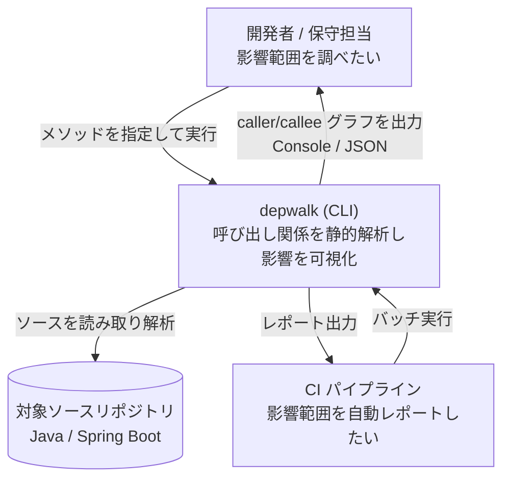

# depwalk PRD

## Overview / Problem Statement

depwalk は、ソースコードの静的解析でメソッド間の呼び出し関係を抽出し、変更の影響範囲の調査を支援する CLI ツールである。  
「あるメソッドを直したいが、どこから呼ばれ、どこを呼んでいるか」を手作業で追う負荷を自動化し、CI の上でも実行できる形で提供する。

対象の言語は Java と Spring Boot から始める。  
将来は Kotlin、TypeScript、Vue、Go の解析を足せるようにする。

## Background

### 業務システムでは、メソッド 1 つの改修の影響範囲の調査に時間がかかる

大規模なシステム、特に業務システムでは、メソッドを変えるときの影響範囲の調査が大きなコストになっている。  
メソッド 1 つの改修でも、呼び出し元が Controller、Batch、Facade、Test などに広く散らばり、手作業での洗い出しに時間を要する。

`UserService.findById()` を修正したいときは、いまは次の作業が手で発生する。

```text
UserService.findById() を修正したい
  ↓ どこから呼ばれているのか分からない
  ↓ Controller / Batch / Facade / Test を手作業で調査
```

### IDE と grep では、プロジェクト全体を横断した網羅的な調査ができない

IDE の Call Hierarchy は、ファイルやモジュールの単位の探索に強い。  
一方で、プロジェクト全体を横断した網羅的な呼び出し関係の抽出には向かない。  
grep は、網羅性と再帰性のどちらも担保できない。

### Spring の DI では、コード上の呼び出し先と実体が一致しない

interface を経由した呼び出しと Bean の注入では、コード上の呼び出し先と実体が一致しない。  
静的に追うには、DI を解決する必要がある。

### IDE に頼る調査は、CI で自動化できない

IDE に頼る調査は、人の手を前提にしている。  
pull request のときなどに、影響範囲を自動でレポートする手段がない。

## Goals

対象の利用者は次の 2 者。

- 開発者と保守の担当者: メソッドを変える前に、影響範囲を調べたい。
- CI のパイプライン: 影響範囲を自動でレポートしたい。

利用者は、メソッドを指定して実行するだけで、そのメソッドの呼び出し元を再帰的に、呼び出し先を探索して得られる。  
Spring の DI を経由する呼び出しも、実体のメソッドまでたどれる。  
結果は Console と JSON で受け取れ、CI からも同じように実行できる。

## Lower-Priority Goals

次の機能は、最初のバージョンの後に、次の順で提供する。

1. グラフの永続化（コミットの SHA の単位）
   - 再解析を避け、2 つの時点の差分に答えられるようにする。差分とは、その pull request で影響範囲がどう変わったかである。
   - [codebase.md の State Ownership](context/codebase.md#state-ownership) の「永続的なストアを持たない」を変えるため、着手するときに ADR を書く。
2. CI との連携
   - SHA ごとのグラフを Artifact にし、pull request へ影響範囲をコメントする。
   - グラフの永続化の上に乗る。永続化がないと毎回すべてを解析することになり、実用に耐えない。

その先に、次のものを置く。順序は決めていない。

- CLI の使い勝手: 解析中の進捗の表示、method selector が曖昧なときの候補の選択、結果の絞り込み、診断の要約の表示
- 解析の精度の残り
  - 外部のライブラリの型を根拠にする chain と、一意に絞れない overload が、未解決のまま残る。実環境で測ると、全 call site の 1.3%〜2.3% にあたる。
    - ADR-0004: [動的呼び出しの完全追跡を初期スコープに含めず、候補と未解決理由を観測可能にする](adr/0004-defer-runtime-call-tracing.md)
  - どちらも診断として観測できる。推測で埋めると誤った edge を作るため、取りにいくかは費用対効果で判断する。
- 可視化の再導入
  - 形式は決めない。DOT と Mermaid は外部のレンダラへの依存を利用者に負わせるため、自己完結した単一の HTML を含めて選び直す。
  - ADR-0008: [可視化の出力（DOT / Mermaid）をスコープから外し、解析の精度と永続化を先に進める](adr/0008-defer-graph-visualization.md)
- 多言語への対応: Kotlin、TypeScript、Vue、Go

各項目の完了の条件は、着手するときに決める。

## Non-Goals

次のものは作らない。

- 実行時の計測: Runtime Trace、APM
- 動的な解析: Reflection の解析、AspectJ の Runtime の解析、実行時の Proxy の解析
  - ADR-0004: [動的呼び出しの完全追跡を初期スコープに含めず、候補と未解決理由を観測可能にする](adr/0004-defer-runtime-call-tracing.md)
- CLI のほかの提供形態: IDE の Plugin、Web UI
- グラフの可視化
  - 形式を決めないまま、将来の課題として残す。解析の精度と永続化を優先する。
  - ADR-0008: [可視化の出力（DOT / Mermaid）をスコープから外し、解析の精度と永続化を先に進める](adr/0008-defer-graph-visualization.md)

## User Stories

### 開発者が、直したいメソッドの呼び出し元を手作業で洗い出している

呼び出し元が Controller、Batch、Facade、Test に散らばり、IDE と grep では網羅できない。  
How Might We: メソッドを 1 つ指定するだけで、そこへ到達する呼び出し元を漏れなく再帰的に列挙するには。

### 開発者が、あるメソッドが何を呼んでいるかを追っている

How Might We: 指定したメソッドから呼び出し先をたどり、変更が波及する先を列挙するには。

### 開発者が、interface 越しの呼び出しの実体を探している

Spring の DI では、コード上の呼び出し先が interface で、実体の実装クラスがコードから直接読めない。  
How Might We: interface の注入を経由する呼び出しを、実装クラスのメソッドまでたどるには。

### CI が、pull request ごとに影響範囲を報告できない

How Might We: 人の手を介さずに、pull request のときに CI のジョブから影響範囲をレポートするには。

### 保守の担当者が、Java のほかの言語のプロジェクトも調べたい

How Might We: 言語を足しても、探索と出力の使い方を変えずに済むようにするには。

## Proposed Solution / Feature Description

### Landscape

次の図は、利用者と CI が depwalk を実行し、depwalk が対象のリポジトリのソースを読んで呼び出し関係を返す関係を示す。



### 呼び出し元の探索

指定したメソッドの呼び出し元を再帰的に探索し、到達する呼び出し元を網羅的に列挙する。  
例: `UserService.findById` を指定すると、`UserController.getUser`、`AdminController.getUser`、`UserBatch.execute` が得られる。

### 呼び出し先の探索

指定したメソッドの呼び出し先を探索し、列挙する。  
例: `UserController.getUser` を指定すると、`UserService.findById`、`UserMapper.toResponse`、`AuditService.record` が得られる。

### Spring の DI の解決

Spring の DI を経由する呼び出し先を、実体まで解決する。  
interface を注入している箇所では、実装クラスのメソッドが呼び出し先として現れる。

### 呼び出しグラフの出力

呼び出しグラフを Console と JSON で出力する。

### 言語の追加

言語ごとの解析を、探索と出力から分けて追加できるようにする。  
将来の対象は Java、Kotlin、TypeScript、Vue、Go である。

### Milestones

最初のバージョンは、Java と Spring Boot を対象に、呼び出し元と呼び出し先の探索、Spring の DI の解決、Console と JSON の出力を提供する。  
最初のバージョンの後の段階は、Lower-Priority Goals に挙げた順で進める。  
段階ごとに確かめる問いは未定。

### Success Metrics

- 指定したメソッドの呼び出し元を再帰的に探索し、到達する呼び出し元を網羅的に列挙できる。
  - 確認の方法: サンプルの Java/Spring のプロジェクトで、既知の呼び出し元の集合と CLI の出力が一致する。到達する集合そのものを比べる規則は [Traversal の Design Doc](core/internal/traversal/DesignDoc.md) が定め、CLI の出力の水準の比較は E2E の CLI 層が担う。
- 指定したメソッドの呼び出し先を探索し、列挙できる。
  - 確認の方法: 呼び出し元と同じ。callee の方向で、既知の集合と一致する。
- 呼び出しグラフを Console と JSON で出力できる。
  - 確認の方法: 各形式で parse できる出力が得られる。形式ごとに比べる規則は [Output の Design Doc](core/internal/output/DesignDoc.md) が定め、CLI の出力の水準の比較は E2E の CLI 層が担う。
- Spring の DI を経由する呼び出し先を、実体まで解決できる。
  - 確認の方法: interface の注入を含むサンプルで、実装クラスのメソッドが呼び出し先として現れる。
- 新しい言語の Analyzer を足すときに、Core の変更が `language` の値の追加だけで済む。
  - 確認の方法: 2 つ目以降の言語の Analyzer を足したとき、Core の差分が `core/internal/protocol` の許す `language` の値 1 つの追加だけになる（Protocol だけで結合する）。
  - 最初の Analyzer である Java を入れるときの、言語に依存しない最初の配線（`depwalk analyze` のコマンドと、Analyzer の起動のコマンドの解決）は対象外とする。

## Open Questions / Risks

### Open Questions

- 最初のバージョンの後の各段階で確かめる問いは未定である。

### Risks

- 未定。
