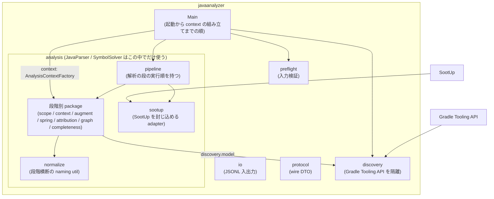
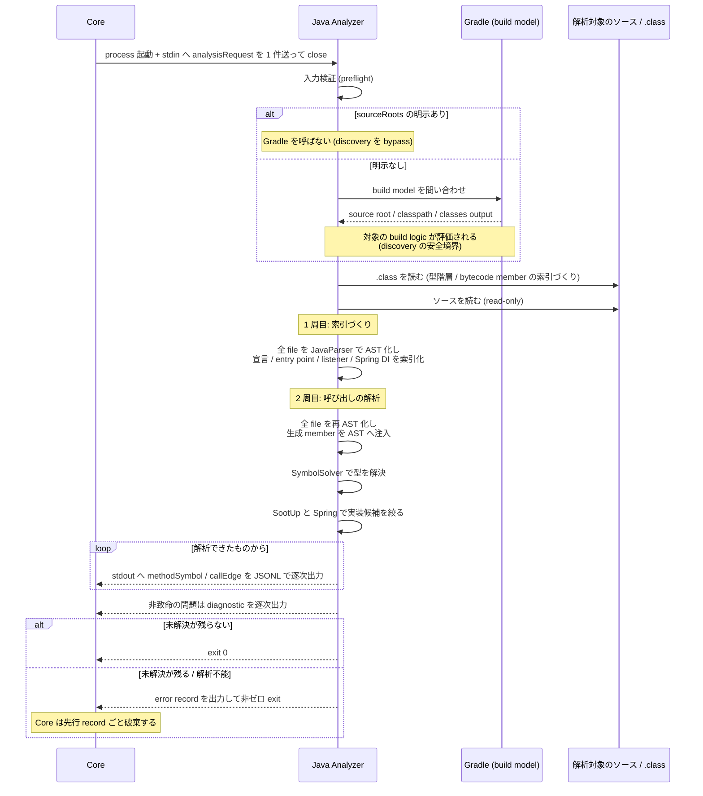
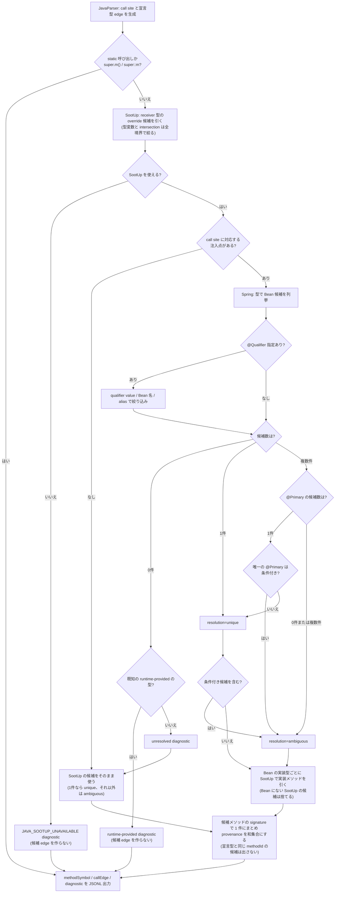

# Java Analyzer

## Overview

Java Analyzer は、Java/Spring のソースを読み、メソッドの呼び出し関係を抽出する言語別の Analyzer である。  
Analyzer Protocol の SPI と JSONL のスキーマを実装する最初の言語別 Analyzer で、Core の契約へ JSONL を出力する。  
全体の構成は [Design Doc の Components](../../design/DesignDoc.md#components) にある。  
ADR-0001: [Analyzer Protocol を JSONL の process SPI にする](../../adr/0001-analyzer-protocol-jsonl-spi.md)

契約の受け側は Core が持つ。  
Protocol の parser と validator は `core/internal/protocol` が、Analyzer のプロセスの起動は `core/internal/analyzer` が担う。  
共通の契約（SPI、JSONL の Protocol、Model のスキーマ）は [Analyzer Protocol の Design Doc](../../core/internal/protocol/DesignDoc.md) にある。

Java Analyzer は、[PRD の Success Metrics](../../PRD.md#success-metrics) のうち次を支える。

- 呼び出し元と呼び出し先の探索の網羅性。
  - graph の入力を供給する。
- Spring の DI を経由する呼び出し先の解決。
- 2 つ目以降の言語の Analyzer を足すときに、Core の変更を `language` の値の追加に限ること。

この文書は、Java Analyzer の全体（実装の基盤、内部の package 構成と外部ライブラリの隔離、起動の契約、性能の方針）を持つ。  
個別の規則は次の 3 つの文書にある。

- [discovery](src/main/java/com/fukuemon/depwalk/javaanalyzer/discovery/DesignDoc.md): 解析の対象のソースと classpath を決める（Gradle の build model と安全の境界）。
- [解析エンジン](src/main/java/com/fukuemon/depwalk/javaanalyzer/analysis/DesignDoc.md): ソースから呼び出し関係を解決する（型の解決、Spring の DI、完全性）。
- [Protocol への写像](src/main/java/com/fukuemon/depwalk/javaanalyzer/protocol/DesignDoc.md): 解析の結果を Protocol の record へ写す（正規化、帰属型、metadata、diagnostic）。
  - pre-flight が検証する metadata の規則は、Protocol への写像の文書にある。
    - そのうち `gradleJavaHome` が指す Gradle の daemon の JVM の規則は、discovery の文書にある。

## Scope

持つものは次のとおり。

- JavaParser による Java のソースの AST の解析と、SymbolSolver による型の解決で、静的な呼び出しを抽出する。
- 抽出の結果を、Analyzer Protocol の JSONL のスキーマ（`methodSymbol`、`callEdge`、`diagnostic`、`error`）で stdout へ出力する。
- `analysisRequest` を stdin から受け取り、process contract（exit code、stderr）を守る。
- Java Analyzer の build と配布の形（Gradle と Shadow のプラグイン、単一の fat jar）
- Core から起動される形（fat jar を `java -jar` で起動する）
- 未解決の symbol と部分的な解析を表す `diagnostic`
- SootUp による型の階層の補完、Interface Dispatch と Override の解決、Spring の Bean と DI の解決、候補の edge の統合の契約
- single-project と multi-project を同じ request で扱う Gradle の build model の discovery と、source root の明示の override
- parse、resolution、生成された member を含む call inventory の完全性の gate
- framework が起動する暗黙の呼び出しの解決（entry point の分類、イベントの edge、callable invocation）
- 型伝播救済層（generic signature の前進の導出による receiver の型の復元と、bytecode の救済への接続）

持たないものは次のとおり。

- 共通の契約（SPI、Protocol、Model のスキーマ）の定義と変更。
  - [Analyzer Protocol の Design Doc](../../core/internal/protocol/DesignDoc.md) が持つ。
- グラフの探索。
  - [Traversal の Design Doc](../../core/internal/traversal/DesignDoc.md) が持つ。
- 出力の整形。
  - [Output の Design Doc](../../core/internal/output/DesignDoc.md) が持つ。
- SootUp への call graph の生成の委任。
  - SootUp に任せる範囲は「解析の 3 段」の節にある。
- Reflection、AspectJ Runtime、実行時の Proxy の動的な解析。
  - 全体の Non-Goals に当たる。
  - ADR-0004: [動的呼び出しの完全追跡を初期スコープに含めない](../../adr/0004-defer-runtime-call-tracing.md)
- CLI の引数の完全な仕様（出力の形式、探索の方向、深さの上限などの flag の体系）。
  - [CLI の Design Doc](../../core/internal/cli/DesignDoc.md) が持つ。
- CLI の flag と環境変数による起動のコマンドの解決。
  - [CLI の Design Doc の「Analyzer の起動コマンドの解決と分割」](../../core/internal/cli/DesignDoc.md#analyzer-の起動コマンドの解決と分割) が持つ。

## Design

### 解析の 3 段

Java のソースから「どのメソッドがどのメソッドを呼んでいるか」を出すには、次の 3 段を踏む。

1. 構文を読む: ソースを構文木（AST）にし、「ここにメソッドの呼び出しがある」まで分かる。
   - [JavaParser](https://javaparser.org/) を使う。
2. 型を決める: その呼び出しが**どの型の**どのメソッドかを決める。
   - `user.save()` の `user` が何型かを解く。
   - SymbolSolver（JavaParser の `javaparser-symbol-solver-core`）を使う。
3. 実装の候補を絞る: interface を越える呼び出しについて、実装クラスの候補を挙げる。
   - [SootUp](https://soot-oss.github.io/SootUp/latest/) と Spring の DI の情報を使う。

2 が解けないと、呼び出し先を特定できず、edge を出せない。  
Java Analyzer の規則の大半は、2 と 3 をどこまで、どう解くかを決めている。

SootUp は、JVM の bytecode を読んで型の階層や call graph を扱う静的解析の基盤である。  
depwalk は、SootUp を型の階層と、override と interface の実装の候補の索引としてだけ使い、call graph の生成は任せない。  
ADR-0005: [SootUp と Spring DI の解決を段階導入する](../../adr/0005-adopt-sootup-and-spring-di-resolution.md)

### Java Analyzer の文書で使う語

型の解決に要る入力の語は次のとおり。

- classpath: 型を解決するために参照する場所の一覧。
  - 依存のライブラリの jar と、compile 済みのクラスの置き場からなる。
  - 出典: [JDK の `--class-path`](https://docs.oracle.com/en/java/javase/25/docs/specs/man/java.html)
- classes directory: compile 済みの `.class` が置かれるディレクトリ。
  - Gradle なら `build/classes/java/main` である。
  - classes output も同じものを指す。
- bytecode member: ソースには現れないが `.class` にはあるメソッドやコンストラクタ。
  - Lombok が生成する getter とコンストラクタが典型である。
  - ソースだけを見ても分からないため、`.class` を読んで補う。
  - 出典: [Lombok の constructor](https://projectlombok.org/features/constructor)
- source root: 解析の対象のソースが置かれたディレクトリ（`src/main/java` など）。

依存のライブラリのソースは手元にないため、型の解決は `.class` を読んで行う。  
classpath が欠けると、型の分からない呼び出しが増え、edge が落ちる。

結果の扱いに使う語は次のとおり。

- adjacency: 隣接関係。
  - どの node からどの node へ edge が伸びているかの対応表。
- provenance: その edge が**どういう根拠で出たか**。
  - ソースの呼び出しから直接出たか、Spring の DI の解決を経たかなどを表す。
  - 同じ edge が複数の根拠で出たときに統合する。
- 完全性の gate: 解析しきれなかった呼び出しが残ったまま結果を返さないためのチェック。
  - 未解決が残れば失敗として扱う。
- 救済: 一次の解決ができなかった呼び出しを、別の手段（`.class` を読むなど）で解き直すこと。

範囲と失敗の扱いの語は次のとおり。

- workspace: 解析の起点のディレクトリ。
  - 利用者が `depwalk analyze <path>` で渡したもの。
- scope（解析の scope）: node として出す対象の範囲。
  - scope の内は自分のコード、scope の外は依存のライブラリや JDK である。
  - scope の外のメソッドは、影響の調査に使わないため、原則として node にしない。
- record: Analyzer が stdout へ 1 行ずつ出す JSONL の 1 件。
  - `methodSymbol`、`callEdge`、`diagnostic`、`error` の 4 種がある。
- diagnostic: 解析を続けられる問題の報告。
  - 出しても結果は返る。
- fatal: 解析を続けられない問題。
  - `error` record を出して非ゼロで終了し、**それまでに出した record ごと破棄される**。

### 実装基盤

- build のツールは Gradle（Kotlin DSL）にする。
  - `gradlew` の wrapper を同梱し、CI に Gradle の本体の事前のインストールを求めない。
- JDK は 25 LTS にし、Gradle の toolchain で固定する。
  - これは Analyzer のプロセス自身が動く JVM の version で、解析の対象のソースの言語のレベルとは独立に扱う。
- 配布の形は、Gradle の Shadow のプラグインで作る単一の fat jar にする。
  - Core は `java -jar <path>` の 1 つのコマンドで起動できる。
- 実装の言語は Java にし、Kotlin を採らない。
  - ADR-0011: [Java Analyzer を Java で実装し、Kotlin を採らない](../../adr/0011-java-analyzer-in-java.md)

### 内部の package 構成と外部ライブラリの隔離

次の図は、`javaanalyzer` の下の package の構成と、外部のライブラリがどの package に入るかを示す。

- 図は、`io` と `protocol` への矢印を省く。
- 直下の `protocol`（wire の DTO）、`io`（JSONL の入出力）、`preflight`（入力の検証）、`discovery`（Gradle Tooling API の隔離）は、入出力と起動を担う。
- `analysis` の下は、解析の pipeline の段階ごとの package で作る。
  - **解析の段の実行の順は `analysis/pipeline`（`AnalysisRunner`）が持つ。**
  - `AnalysisRunner.run` を呼ぶまでの順は、`Main` が持つ。
    - 順は、request の読み取り、pre-flight、自動 discovery での language の metadata の拒否、discovery である。
    - その後に、解析の context を `AnalysisContextFactory` で組み立てる。
    - ADR-0016: [Java Analyzer の実行の順を、解析の段は AnalysisRunner に、context の組み立てまでは Main に持たせる](../../adr/0016-split-execution-order-between-main-and-runner.md)
  - 段階別の package のうち、`graph` と `spring` は互いに import する。
    - `graph` は `spring` の索引（`SpringDiIndex`、`EventListenerIndex`、`EntryPointIndex`）を読む。
    - `spring` の `SpringDiagnosticEmitter` は、`graph` の `GraphAccumulator` へ diagnostic を足す。
  - `normalize` は、段階を横断する naming の util で、実行の順に位置を持たない。
  - `scope` は glob と path の helper だけを持つ。scope の列挙は `analysis/context` の `ContextScope` が行う。
- 外部のライブラリは 3 段に分けて隔離する。
  - SootUp は `analysis/sootup` の adapter に完全に封じ込める。
    - facade が自前の型で公開し、他の package から `sootup.*` を import しない。
  - Gradle Tooling API は `discovery` に完全に隔離する。
  - JavaParser と SymbolSolver は、解析エンジンの中核として `analysis` の下では自由に使い、`analysis` の外へは漏らさない。
  - ADR-0007: [Core と Java Analyzer の依存境界を ACL と機械のチェックで固定し、Core はフラットな package 構成のまま保つ](../../adr/0007-layered-architecture-refactor.md)
- 依存の境界は ArchUnit の JUnit のテストで機械的にチェックする。
  - import してよい範囲とチェックの実行点は [codebase.md の Dependency Rules](../../context/codebase.md#dependency-rules) にある。

`AnalysisRunner` が実行する段階の順と、各段階を担う package は次のとおり。

| 順  | 段階                                                                                       | package                                                      |
| --- | ------------------------------------------------------------------------------------------ | ------------------------------------------------------------ |
| 1   | workspaceRoot の real path 化と scope の列挙                                               | `analysis/context`（`ContextScope`）、`analysis/scope`       |
| 2   | bytecode の索引の構築（context ごとの SootUp の型の階層と、project の bytecode member）    | `analysis/sootup`、`analysis/completeness`                   |
| 3   | context の構築（context ごとの TypeSolver、parser、AST の injector の生成）                | `analysis/context`、`analysis/augment`                       |
| 4   | parse の pre-flight と、成功した後の context の warning の出力                             | `analysis/context`（`ParsePreflight`）、`io`                 |
| 5   | attribution の準備（`liftExcludePackages` の解決と、帰属型の resolver の生成）             | `analysis/attribution`                                       |
| 6   | first pass（索引の構築と Spring DI の diagnostic）                                         | `analysis/completeness`、`analysis/spring`、`analysis/graph` |
| 7   | builder の構築（context ごとの `CallGraphBuilder`）                                        | `analysis/graph`                                             |
| 8   | second pass（bytecode にだけある member の AST への注入と、`CallGraphBuilder` による解析） | `analysis/augment`、`analysis/graph`、`io`                   |
| 9   | completeness gate                                                                          | `analysis/completeness`                                      |

- 段 2 の bytecode の索引は、段 3 の TypeSolver が bytecode member の合成に使うため、段 3 より先に作る。
  - 合成の規則は [解析エンジンの文書の「solver の層での bytecode member の合成」](src/main/java/com/fukuemon/depwalk/javaanalyzer/analysis/DesignDoc.md#solver-の層での-bytecode-member-の合成) にある。
- 段 6 の first pass は、全 file を parse し、inventory、宣言の索引、entry point、event listener、callable、source method、Spring DI を索引にする。
- 段 8 の second pass は、全 file を再び parse する。
- `fullGraph` の record は、段 8 の中で file ごとに逐次に出力する。そのため、出力は段 9 の completeness gate より先に始まる。
- `reachableFromEntrypoints` の record は、段 8 の後、段 9 の前にまとめて出力する。

### 起動から結果を返すまで

次の図は、Core が Analyzer を 1 回呼んだときの全体の流れを示す。  
各段の規則は下位の 3 つの文書にある。

全 file を 2 周するのは、同じ compilation unit の中の参照と、framework が起動する呼び出しを解くためである。  
1 周目の索引が揃わないと、2 周目の解決ができない。  
各周で行うことの規則は [解析エンジンの文書](src/main/java/com/fukuemon/depwalk/javaanalyzer/analysis/DesignDoc.md) にある。

出力は**逐次**である。  
解析が全部終わってからまとめて返さず、確定したものから流す。  
ただし `reachableFromEntrypoints` は、到達の判定に解析の全体が要るため例外にする。  
扱いは「analysisMode の意味論」の節にある。

流れの中の個別の規則は次のとおり。

- Core は Analyzer のプロセスを起動し、stdin へ `analysisRequest` を 1 件送って close する。
  - Java Analyzer は対象の Java のソースを読み取り専用で解析し、結果を stdout へ JSONL で逐次出力する。
- 呼び出し先の型を解決できたときは、caller と callee の両方の `methodSymbol` と、両者を参照する `callEdge` を出力する。
- 呼び出し先が interface か抽象メソッドのときは、帰属型の決定規則で決まる帰属型のメソッドを callee として `callEdge` を出力する。
  - `callEdge.metadata.dispatch` に dispatch の種別を付ける。
- 呼び出し先のメソッドの宣言サイトが scope の外で、その宣言型が引き上げから外す package に属するときは、`methodSymbol` と `callEdge` を出力しない。
  - 解析の失敗ではないため、`diagnostic` も出さない。
- framework が実行時に起動する呼び出しも、ソースの上に根拠がある範囲で edge にする。
  - `publishEvent` から `@EventListener` のメソッドへのイベントの edge を出す。
  - functional interface の invocation site から実体への callable invocation の edge を出す。
- framework が直接起動しうるメソッドには、`methodSymbol.metadata.entryPoint` を付ける。
  - edge は作らず、caller の探索の終端の根拠だけを与える。
- allowlist にある resolution failure は、call outcome ledger に候補と理由を記録して、解析を続ける。
  - ただし、すべての救済の後も primary diagnostic が残る request は、`JAVA_INCOMPLETE_ANALYSIS` で fatal にする。
- 個別のファイルを parse できないときは、graph の record を 1 件も確定しない。
  - 決定順で最初の parse failure を、`JAVA_PARSE_ERROR` の message の文字列として返し、fatal にする。
- 解析を続けられない致命的な問題が起きたときは、`error` record を出力し、非ゼロの exit code で終了する。

各規則の詳細は次の文書にある。

- 帰属型の決定規則と `dispatch` の値: [Protocol への写像](src/main/java/com/fukuemon/depwalk/javaanalyzer/protocol/DesignDoc.md)
- イベントの edge、callable invocation、entry point の対象のアノテーション、完全性の gate: [解析エンジン](src/main/java/com/fukuemon/depwalk/javaanalyzer/analysis/DesignDoc.md)

### Interface Dispatch と Spring DI の解決の流れ

次の図は、call site から実装の候補を絞り込み、候補の edge を統合するまでの流れを示す。

Spring の絞り込みの後に、JavaParser の側で候補の edge を作り、同じ候補の provenance を統合する。  
宣言型 edge は、どの分岐でも残す。  
注入点が Bean の候補を持つ場合は Bean の候補だけを出す。注入点がないか、Bean の定義が見つからない（unresolved）場合は SootUp の候補を出す。runtime-provided の型では、候補の edge を出さない。

### 解析の手段の範囲

呼び出しの抽出は、次の 2 つの手段を重ねて行う。

- 静的な呼び出しの抽出: JavaParser と SymbolSolver で、呼び出しと型を解決する。
- SootUp と Spring の解析: SootUp が型の階層、Interface Dispatch、Override の候補を補い、Spring の Bean と DI の解決が候補を絞り込む。
  - これで Spring の DI を経由する呼び出し先の解決を満たす。

SootUp の view を lazy に構築する規則は「性能の方針」の節にある。

Lombok が生成するコンストラクタ（`@AllArgsConstructor`、`@RequiredArgsConstructor` など）は、ソースからは見えない。  
そのため、SootUp が bytecode の型の階層を引く対象に、自分のプロジェクトの compile 済みの class を含めて解決する。

- 解析の対象のプロジェクトは、解析の時点で compile 済み（`.class` を生成済み）であることを前提にする。
- build していない場合は、`JAVA_SOOTUP_UNAVAILABLE` の diagnostic を出し、JavaParser の結果だけでソースだけの解析を続ける。
- 自分のプロジェクトの compile 済みの class も、解析の対象のソースや依存の jar と同じく、読み取り専用として扱う。
  - 書き込みと実行はしない。

Reflection、AspectJ Runtime、実行時の Proxy のように、実行時の状態で初めて確定する呼び出しの完全な追跡は扱わない。  
静的に候補を導けるときは、候補と根拠を出力する。  
確定できないときは、候補と未解決の理由を観測できるようにする。  
ADR-0004: [動的呼び出しの完全追跡を初期スコープに含めない](../../adr/0004-defer-runtime-call-tracing.md)

静的に解けない framework の仕組みは、次の 2 つの規則で扱う。

- Spring の条件アノテーション: `@Profile`、`@ConditionalOnProperty` などの条件アノテーションは、条件を評価せず、検出と記録だけを行う。
  - 条件付きの Bean も、無条件に候補として列挙し、条件付きである事実と条件の種別を metadata と diagnostic に記録する。
  - 条件付きの候補を含む場合は、候補が 1 件でも `resolution: unique` にせず、曖昧な候補として扱う。
- 実行時に生成される実装: Spring Data などの実行時に生成される実装は、宣言メソッドへの edge だけを残し、疑似の実装の node を合成しない。
  - 既知の runtime-provided のマーカーは、Spring Data の `Repository` の型の階層と、MyBatis の `@Mapper` の interface の 2 つにする。
  - MyBatis を含めるのは、framework が実行時の proxy を生成し、ソースに実装クラスがない点で、Spring Data と同じ構造だからである。
  - マーカーに合う場合は、diagnostic の理由を「未解決」と区別し、「runtime-provided」にする。
  - `@FeignClient` などのその他の framework は対象に含めない。

### analysisMode の意味論

`fullGraph` と `reachableFromEntrypoints` の両方を実装する。

| モード                     | 出力の範囲                                                                                                |
| -------------------------- | --------------------------------------------------------------------------------------------------------- |
| `fullGraph`                | scope（`include` と `exclude` を適用した後）の中の全 `methodSymbol` と、その間の全 `callEdge`             |
| `reachableFromEntrypoints` | `entrypoints` から呼び出し先（callee）の方向に推移的に到達する `methodSymbol` と、それらの間の `callEdge` |

- `entrypoints` が未指定か空の配列のときは、`analysisMode` の値によらず、scope の全体の call graph の生成の要求として扱う。
- node の母集合（どのメソッドを `methodSymbol` として出すか）の列挙の方法は、[Protocol への写像の文書](src/main/java/com/fukuemon/depwalk/javaanalyzer/protocol/DesignDoc.md) の帰属型の決定規則にある。
- `reachableFromEntrypoints` は、caller の探索の入力としては不完全である。
  - そのため、caller の方向の問い合わせでは、Core が `fullGraph` を選ぶ責務を持つ。
  - この文書が定めるのは Java Analyzer の側の意味論だけで、Core の振る舞いは参照にとどまる。
- `reachableFromEntrypoints` は、callee の方向の調査で出力の量を減らすための最適化と位置づける。

### 性能の方針

`reachableFromEntrypoints` は、entrypoints からの到達の判定に、解析が終わるまでの adjacency の全体を要し、streaming と両立しない。  
このため、モードごとに挙動を分ける。

- `fullGraph`: ファイル単位の解析が終わるごとに、新たに確定した `methodSymbol`、`callEdge`、`diagnostic` を stdout へ flush する。
  - flush は出力済みの index を進めるだけで、要素は捨てない。
- `reachableFromEntrypoints`: 到達の判定のため、逐次の flush を行わない。
  - 解析が終わった後に到達の集合を確定してから一括で出力する二段の処理を、**モード別の例外**として許す。

逐次に捨てるのは AST だけにする。  
ファイル単位で parse した AST は、処理の後に参照を手放す。  
それ以外は、モードを問わず実行の終わりまで保持する。

- node、edge、diagnostic は、両方のモードで `GraphAccumulator` が追加だけの list で保持する。
  - モードで変わるのは、writer へ流す timing だけである。
- SymbolSolver の型の解決のキャッシュも、実行の終わりまで残る。
- first pass で作る索引と call outcome ledger も、run の全体で保持する。
  - 索引は、inventory、宣言の索引、entry point、event listener、callable、source method、Spring DI である。

その他の方針は次のとおり。

- 解析したファイルの数、所要時間、未解決の件数を stderr に出力する。
  - protocol の record としては出さない。
- `fullGraph` と `reachableFromEntrypoints` は record の出力の timing が違うため、数値の目標はモード別に扱う。
  - グラフの本体の保持量そのものは、モードで変わらない。
- **SootUp の view の構築は lazy に行う。**
  - 型の階層の解決に要るクラスだけを読み込み、全クラスを eager に読み込まない。

## Interface

### 置くファイル

- `analyzers/java/build.gradle.kts`: Java Analyzer の依存、JDK の toolchain、Shadow のプラグイン、`gradleCompatibilityTest` の task
- `analyzers/java/model-provider/`: Gradle の daemon で読み込まれる custom model provider
- `analyzers/java/build/libs/java-analyzer.jar`: `./gradlew shadowJar` が作る fat jar

### 起動の契約

Java Analyzer は、Core が解決した起動コマンドで、独立したプロセスとして起動する。  
起動コマンドを解決する順序と分割の規則は、[CLI の Design Doc の「Analyzer の起動コマンドの解決と分割」](../../core/internal/cli/DesignDoc.md#analyzer-の起動コマンドの解決と分割) にある。  
ADR-0003: [Analyzer 起動コマンドを言語非依存な文字列として解決する](../../adr/0003-analyzer-command-resolution.md)

metadata の受け渡しも、同じ言語非依存の原則に従う。  
Core は `--analyzer-meta key=value` を `analysisRequest.metadata` へ渡すだけで、key と value の意味を解釈しない。  
Core が metadata を組み立てる規則は [CLI の Design Doc の「`--analyzer-meta` の合成」](../../core/internal/cli/DesignDoc.md#--analyzer-meta-の合成) にある。  
Java に固有の key は [Protocol への写像の文書](src/main/java/com/fukuemon/depwalk/javaanalyzer/protocol/DesignDoc.md#metadata-契約) にある。

### チェック

- `cd analyzers/java && ./gradlew test`: Java の unit テストと、依存の境界をチェックする ArchUnit のテストを実行する。
- `cd analyzers/java && ./gradlew gradleCompatibilityTest`: Gradle と daemon の JVM の互換の matrix を確かめる。
  - 確かめる観点は [discovery の文書の Verification](src/main/java/com/fukuemon/depwalk/javaanalyzer/discovery/DesignDoc.md#verification) にある。
- テストのコマンドと実行の前提は [context/testing.md](../../context/testing.md) にある。

## Verification

Java Analyzer は、Java の unit、Go の fake analyzer、実際の jar による E2E の三層で保証する。  
テストの責務の分担と test runtime contract は [context/testing.md](../../context/testing.md) にある。

曖昧さと解決の根拠の観測は、Analyzer の JSONL（`callEdge.metadata` と `diagnostic`）までを Java Analyzer の責務にする。  
CLI の出力への edge 単位の metadata の表出は、[CLI の Design Doc](../../core/internal/cli/DesignDoc.md) が定める。

### Java の unit テストで確かめること

JUnit で、`analyzers/java/` の中で確かめる。

- signature と `methodId` の正規化
  - overload、generics の erasure、varargs、nested class（`$`）
  - constructor（`<init>`）、static initializer（`<clinit>`）、匿名クラスの採番の決定性
- `symbolKind` の割り当て
  - インスタンス初期化子とフィールド初期化子が constructor に畳み込まれること
  - lambda の中の呼び出しが囲みメソッドに帰属し、`viaLambda: true` が立つこと
- 帰属型の決定規則
  - 宣言サイトが scope の中（override あり、なし）、scope の外の宣言の引き上げ
  - 引き上げから外す package（既定値と `liftExcludePackages` による置き換え、segment 単位の prefix 一致）
  - `this`、`super`、static、`new` の各形、`metadata.dispatch` の値
- `diagnostic` と `error` の code と severity の対応と、pre-flight のチェックが解析の開始の前に fatal になること
  - `language != "java"`、`workspaceRoot` が存在しないか directory でない
  - 明示の `sourceRoots` の方式での classpath の key の不在、classpath の entry の欠落と読み取り不能
  - `liftExcludePackages` が文字列の配列であること（空の配列は「除外なし」として正当）
  - `allowIncompleteAnalysis` が要素 1 の `["true"]` か `["false"]` であること
  - `gradleJavaHome` の受理と拒否。規則は [discovery の文書](src/main/java/com/fukuemon/depwalk/javaanalyzer/discovery/DesignDoc.md#daemon-の-jvm-の明示の指定) にある。
- discovery の context
  - explicit と auto の排他の validation、root の正規化、重複、包含、realpath の境界
  - custom model、main source set、project の依存の到達性、context ごとの language level と preview
- 完全性の gate
  - parse の pre-flight、allowlist の外の resolver の fatal、atomic な mutation、call inventory と outcome ledger
  - initializer の caller の展開、`silentOmission == 0`、共通の failure details
- bytecode member
  - call site が駆動する project の bytecode member の index
  - bytecode にだけある member の location の省略と owner の metadata、Graph の deep copy
- `fullGraph` と `reachableFromEntrypoints` の出力の範囲
  - 宣言の列挙と call site 由来の和集合、entrypoints が空なら全体として扱うこと
- entry point の分類
  - 対象のアノテーションの検出、1 段の合成アノテーション、対象外の形で検出しないこと、`metadata.entryPoint` の値
- イベントの edge
  - publisher の判定、引数の型と型の階層による listener の突合、無条件の listener の `unique`
  - 条件付き、generics、SpEL の属性での `ambiguous` への降格、突合できないときの diagnostic
- callable invocation
  - method reference と lambda の edge の先、`viaCallableInvocation` の標識
  - local 変数を経由する場合と parameter 1 段の追跡の範囲、対象外の形で edge を張らないこと
- 同じ compilation unit の中での、bytecode にだけある member の AST への注入と、暗黙の宣言を注入しないこと
- 型伝播救済層の generic の前進の導出
  - chain link の型引数の伝播、固定表の適用の範囲、`java.lang.Object` での打ち切り
- **複数の context（依存する project の関係）を要する規則**（cross-module の bytecode の救済など）は、`MultiContextAnalysisTestSupport` で検証する。
  - in-memory の fake の build model から、本番の context の構築（`discoveredContexts`）を通し、`AnalysisRunner` を直接動かす。
  - build model は、Tooling API が構造的に adapt する interface である。
    - そのため fake でも、root の検証と依存する context の id の導出は本番のコードが行う。
  - model の取得（Tooling API、Gradle の daemon、provider の配布）を実際の Gradle で確かめるテストは、[context/testing.md](../../context/testing.md#test-types-and-guarantees) にある。
- Gradle の output の破棄と、negative fixture の非漏洩
  - `CredentialIsolationTest` は、実際の Gradle で build logic が出した credential 相当の marker が、Protocol、stderr、生成物に現れないことを確かめる。
  - Gradle の失敗の message の URL が出力に現れないことは、fake の Tooling API で確かめる。
  - Gradle と daemon の JVM の anchor の matrix は、`gradleCompatibilityTest` で確かめる。
  - 観点は [discovery の文書の Verification](src/main/java/com/fukuemon/depwalk/javaanalyzer/discovery/DesignDoc.md#verification) にある。

起動のコマンドの解決と `--analyzer-meta` の合成を、fake analyzer で確かめる観点は [CLI の Design Doc の Verification](../../core/internal/cli/DesignDoc.md#verification) にある。

### E2E で確かめること

実際の jar と `testdata/fixtures/java/` を使う。

- 既知の caller と callee の集合と、解析の結果の graph を比べる。
  - これは呼び出し元と呼び出し先の探索の入力の層に当たる。
    - CLI の出力の水準の比較は CLI の層が担う。
- interface の注入を含むサンプルで、宣言型（interface）のメソッドが callee に現れ、`dispatch: interface` が立つこと
  - これは Spring の DI の解決の前段に当たる。
- parse できないファイルを混ぜた fixture で、`JAVA_PARSE_ERROR` の message が決定順で最初に失敗した file の相対 path を含み、graph と diagnostic を公開しないこと
- 未解決の symbol を含む fixture で、救済できない primary outcome が `JAVA_INCOMPLETE_ANALYSIS` の全 detail を返し、不完全な graph を成功させないこと
- **完全性の gate の opt-in の緩和**。
  - `metadata.allowIncompleteAnalysis=["true"]` のとき、primary diagnostic が残っていても exit 0 で成功すること。
  - そのとき、解決済みの edge と node と、`diagnostic` record が公開されること。
  - `callSiteSummary` の `diagnostic[...]` の集計が残った件数と一致し、`silentOmission=0` を保つこと。
  - 不正な値（`["true"]` と `["false"]` 以外）は `JAVA_INVALID_REQUEST` で fatal になること。
- 自動 discovery と明示の override の graph が一致すること
  - fixture は、app、service、repository の 3 つの project、変えた `projectDir`、独自の source のディレクトリ、project の間の呼び出しと DI を含む。
- テスト専用の透過の proxy を介して、実際の Core の CLI と実際の Analyzer の jar をつなぎ、request、raw の graph、CLI の終了の状態を E2E の CLI 層で比べること
  - CI の E2E の job で動かし、JDK か jar が欠けたときは skip せずに失敗にする。
- **Spring Boot の fixture**: `testdata/fixtures/java/spring-project/` に、単一の source root の Spring の fixture を置く。
  - DI（constructor、field、setter の injection）、stereotype、`@Qualifier`、`@Primary` を含む。
  - 条件付きの Bean（`@Profile`、`@ConditionalOnProperty`）と、Spring Data の Repository を含む。
- **Lombok と MyBatis の Mapper**: Spring Boot の fixture に、次の 2 つを含める。
  - コンストラクタを Lombok（`@AllArgsConstructor`、`@RequiredArgsConstructor` など）で生成するクラス
  - MyBatis の `@Mapper` の interface
  - 前者は、自分のプロジェクトの compile 済みの class を通じた constructor injection の解決を検証する。
  - 後者は、runtime-provided のマーカーの検出を検証する。
- **未解決の call のパターンの fixture**: `testdata/fixtures/java/multi-module-spring-project/patterns/` に、実環境の計測で上位だった未解決のパターンの最小の再現を置く。
  - パターンは、lambda や generic を含む fluent chain、`var` と generic メソッドの戻り値、method reference である。
  - 明示の `super(...)` と、cross-module の Lombok が生成した member の呼び出しもパターンに含む。
  - 各パターンは、bytecode にだけある member の契約の下で edge になる。
  - この成功の期待は、required の E2E（`core/e2e/hard_to_resolve_call_patterns_cli_test.go`）が守る。
  - `JAVA_INCOMPLETE_ANALYSIS` のときの診断の metadata の 4 項目（sanitize の制約を含む）の期待値は、Java の unit テストの側が検証する。
- **metadata の透過の表出の CLI での比較**: Analyzer が付けた metadata が、欠けずに CLI の出力まで届くことを、次の 3 本で比べる。
  - `core/e2e/event_edges_cli_test.go`、`core/e2e/callable_edges_cli_test.go`、`core/e2e/entrypoint_metadata_cli_test.go`
  - この 3 本は `testdata/fixtures/java/` を使わず、要る最小のソースを一時の workspace に組み立てて実行する。
  - 検証したい表出だけを含む最小の構成にし、共有の fixture の変更でテストが失敗しないようにするためである。
- **fixture の build と classpath の契約**:
  - `testdata/fixtures/java/spring-project/` は独立した Gradle の project にし、リポジトリの `analyzers/java/gradlew -p` で build する。
  - Java の toolchain と release、依存する framework の jar のバージョンは、fixture の `build.gradle.kts` で固定する。
  - 本物の framework の jar を使う fixture の範囲は [context/testing.md の Mocking and Test Data](../../context/testing.md#mocking-and-test-data) にある。
  - `writeDepwalkClasspath` の task は、`build/classes/java/main` と `runtimeClasspath` の jar を `build/depwalk-classpath.txt` へ書く。
    - 書き方は、絶対 path、辞書順、1 行に 1 entry である。
  - Go の E2E は、その全行を `analysisRequest.metadata.classpath` に渡す。
  - Lombok が生成する constructor は、`classes` の task の後の `.class` で検証する。

### 性能の計測

明示の single-root、自動の single-project、自動の multi-project の 3 つの方式を、初回の 1 回と warm の 3 回の中央値で測る。  
stderr へは、discovery の終了の行の `discoveryMs` と、解析の終了の行の `durationMs`、`parsePreflightMs`、`contextBuildMs` を記録する。  
解析の終了の行は、ほかに `analyzedFiles` と `unresolvedSymbols` を持つ。  
model、resolution、graph の phase ごとの時間は記録しない。

SLO は、計測の結果から次の規則で導く。

- latency: warm の wall の中央値の 1.5 倍を、0.5 秒の単位で切り上げる。
- 最大 RSS: warm の 3 回の最大値の 1.25 倍を、64 MiB の単位で切り上げる。

小さい fixture では JVM の起動と Gradle の daemon の寄与が大きいため、値は「小さいプロジェクトでの下限に近い値」として扱う。

| 方式                      | latency SLO | 最大 RSS SLO |
| ------------------------- | ----------- | ------------ |
| 明示 single-root (8 file) | 3.0s 以下   | 512 MiB 以下 |
| single-project discovery  | 4.5s 以下   | 576 MiB 以下 |
| multi-module discovery    | 4.0s 以下   | 512 MiB 以下 |

SLO は、計測した fixture と環境に対する手動のリリースの目標にする。  
**時間と RSS は、テストの合否の条件にしない。**  
fixture の規模、Analyzer の runtime の JDK、Gradle の major が変わったら、測り直す。
