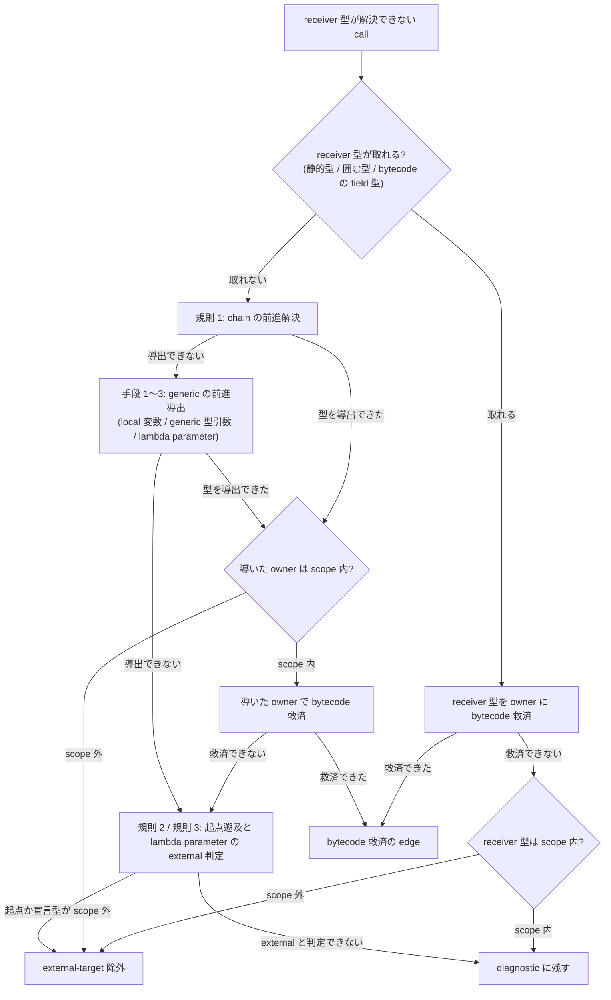

# Java Analyzer: 解析エンジン

## Overview

解析エンジンは、**ソースから呼び出し関係をどう解決するか**を担う。  
JavaParser と SymbolSolver で型を解決し、SootUp で型の階層、override、interface の実装の候補を索引にし、Spring の DI で候補を絞り込む。  
解決できなかった call の扱い（救済するか、未解決として完全性の gate に残すか）も、解析エンジンが持つ。

Java Analyzer の全体は [Java Analyzer の Design Doc](../../../../../../../../DesignDoc.md) にある。  
この文書で使う語（JavaParser、SymbolSolver、SootUp、bytecode member、救済、完全性の gate）も、同じ文書にある。

## Scope

持つものは次のとおり。

- `user.save()` の `user` が何型かを決める方法（型の解決）
- ソースに現れない Lombok の生成メソッドを解く方法（bytecode member の合成と注入）
- interface を越える呼び出しで、実装クラスの候補を絞る方法（Spring DI）
- 解決できなかった呼び出しの扱い。
  - 救済するか、未解決として結果を失敗にするか。
- framework が実行時に起動する暗黙の呼び出しの解決

持たないものは次のとおり。

- source root と classpath の決め方。
  - [discovery の文書](../discovery/DesignDoc.md) が持つ。
- 解決の結果を Protocol の record へ写す規則（methodId、帰属型、metadata、code）。
  - [Protocol への写像の文書](../protocol/DesignDoc.md) が持つ。

## Design

### 型の解決

JavaParser（AST の解析）と SymbolSolver（型の解決）を使い、次の 4 種類の `TypeSolver` をこの順に登録する。

- `ReflectionTypeSolver`（JDK の標準の型）
  - JDK の型は、Analyzer が動く JVM の型を使う。
- `JavaParserTypeSolver`（対象のプロジェクトの source root ごとに 1 つ）
  - bytecode member の索引があるときは、`MemberAugmentingTypeSolver` で包む。
- `JarTypeSolver`（classpath の jar ごとに 1 つ）
- `ClassLoaderTypeSolver`（classpath の classes directory）
  - classpath に classes directory が 1 つでもあるときだけ登録する。
  - classpath の全 entry を 1 つの `URLClassLoader` で共有し、module をまたぐ型の参照でも class の load が失敗しないようにする。

source root の solver を classpath の solver より先に登録し、ソースの宣言を bytecode より優先する。

明示の `sourceRoots` の方式では、`analysisRequest.metadata.classpath` の key を**必須**にする（空の配列でもよい）。  
自動 discovery の方式では、custom tooling model が project ごとの compile classpath と classes output を提供する。  
request の metadata に `classpath` があれば、共通の extra として全 context へ足す。  
自動 discovery のときに `javaLanguageLevel` と `javaPreview` を指定するのは不正にする。  
両 key とも、要素の数が 1 でない配列（0 件、2 件以上）と、string でない要素は、`JAVA_INVALID_REQUEST` として解析の開始の前に拒否する。

`classpath` の各要素には、依存の jar か compile 済みの classes directory を指定できる。  
自分のプロジェクトの bytecode を引くときは、解析の対象のプロジェクトの classes output directory も `classpath` の配列へ足す。  
Gradle なら `build/classes/java/main` である。  
新しい metadata の key は導入しない。  
SootUp は、ソースから得た binary name と一致する `.class` を classpath の上で引き、自分のプロジェクトの class と依存の class を区別する。

pre-flight のチェック（classpath の key の有無、指定した jar か classes directory の存在と読み取りの可否）は、解析の開始の前に一括で行う。  
明示された classpath の entry の欠落と読み取り不能は `JAVA_MISSING_JAR` の fatal にし、`error` record と非ゼロの exit ですぐに止める。  
明示された入力の欠落を部分的な解析へ落とすと、出力済みの `methodSymbol` と `callEdge` が「一見成功した出力」として観測されうるためである。

`JAVA_SOOTUP_UNAVAILABLE` で続けられる fallback は、pre-flight を通った入力について、次の 4 つに限る。

- SootUp が class file を解釈できないか、索引にできない。
- 自動 discovery の model から来た classes output がまだ作られていない。
- 明示の方式で、自分の project の classes output そのものが classpath に指定されていない。
- model から来た compile classpath のうち、workspace の中の project の依存の build output が、build されておらず存在しない。

この 4 つでは、対象と原因を diagnostic に出力し、JavaParser の結果だけでソースだけの解析を続ける。  
workspace の中の build されていない entry を除いても、依存の project の source root が solver へ入るため、型の解決は依存の context のソースが補う。  
model の取得は task を実行しないため、fresh checkout ではこの欠落がふつうの状態である。

次の 2 つの欠落と読み取り不能は `JAVA_MISSING_JAR` の fatal にし、fallback しない。

- 利用者が classpath の entry として明示した classes directory と jar
- model が解決済みの compile classpath として返した、workspace の外の external の artifact

ソースだけでは生成 member を救済できず、primary call diagnostic が残れば、終端で `JAVA_INCOMPLETE_ANALYSIS` になる。  
fatal は、先に出した warning の record を無効にする。  
そのため、SootUp を使えなかった context の数を、`JAVA_INCOMPLETE_ANALYSIS` の error metadata（`sootUpUnavailableContexts`）へ自己完結に持つ。  
bytecode の救済がなかったことが原因の未解決を、fatal の後も診断できるようにするためである。

SootUp の依存は、`sootup.core`、`sootup.java.core`、`sootup.java.bytecode.frontend` の 3 つに限る。  
この 3 つは、bytecode の `AnalysisInputLocation` と `View` に要る最小の module である。  
バージョンは `analyzers/java/build.gradle.kts` にある。  
`sootup.callgraph` は、SootUp に call graph の生成を任せない責務の境界に反するため、足さない。  
ADR-0005: [SootUp と Spring DI の解決を導入する](../../../../../../../../../../adr/0005-adopt-sootup-and-spring-di-resolution.md)

### solver の層での bytecode member の合成

scope の中のソースの型を solver が解決するとき、同じ context の classes output にしかない一意な callable member（Lombok などの生成 member）を、解決の時に合成する。  
call site が駆動する救済（生成 member の索引）だけでは、式の型の伝播（chained call、stream の連鎖）をたどれないためである。

- ソースの宣言と、ソースを優先する帰属の規則は変えない。
- 合成した member の出力は、bytecode にだけある member と同じ契約（定義の位置の省略と owner の metadata）に従う。
- generic の戻り値は、classes output の Signature 属性から実際の型引数を復元する。
- Signature がない member、読めない member、型変数は、erasure（Object）へ落とし、解析は失敗させない。

合成と救済を選ぶ境界は次のとおり。

- 型名を scope にする static call は、instance member を合成も救済もせず、未解決として完全性の gate に残す。
  - 偽の edge を防ぐためである。
- member の候補は、owner の class の classfile が project の所有する classes output にある場合だけ採る。
  - 対象は自分の context と、**model の project の依存の関係で到達できる依存の project の output** である。

### AST への member の注入

solver を経由する合成は、TypeSolver を通らない解決の流れには働かない。  
働かないのは次の 2 つ。

- 同じ compilation unit の中の参照。
  - 自分の class の getter を `this` か暗黙の scope で呼ぶ形、同じ file の local 変数の receiver、switch の selector が当たる。
- solver の内部で parse した AST から直接作られる宣言

実環境で最も多い未解決は、「entity 自身のメソッドの中から、自分の class の生成 getter を呼ぶ」形である。  
そこで、生成 member の宣言そのものを、parse した後の AST へ注入して補う。  
注入する先は、解析の対象の parse の結果と、solver の内部の parse の結果の両方である。  
ADR-0009: [framework 由来の暗黙の呼び出しと型伝播救済](../../../../../../../../../../adr/0009-implicit-call-resolution-and-type-propagation-rescue.md)

注入の対象と除外は次のとおり。

- 対象は class の宣言と enum の宣言にする。
  - interface には生成 member が付かず、record は accessor が言語仕様で暗黙に宣言されるため、対象の外にする。
- 言語仕様が暗黙に宣言する member は注入しない。
  - enum の values と valueOf、javac の暗黙の default constructor と同じ形のものが当たる。
- class には、bytecode にだけある constructor（@AllArgsConstructor など）も注入する。
  - ただし、同じ arity のソースの宣言がない一意なものだけにする。
- 同じ名前と同じ arity が bytecode の上に複数ある member は、曖昧なので注入しない。
  - 合成と同じ一意性の規則である。
- ソースに書けない匿名と local の class の名前（`$` と数字）が、owner か member の型に現れる場合は注入しない。
- 注入するときに型の解決は行わない。
  - solver への再入を防ぐためである。
  - 型は classfile の descriptor と Signature の名前をそのまま書き下す。

注入した宣言は「解決のための標識」で、ソースの宣言としては扱わない。

- caller として walk しない。
  - 呼び出された場合は、bytecode にだけある member と同じ出力の契約（定義の位置の省略、owner の metadata、calleeOrigin）で emit する。
- owner の型が scope（include と exclude を適用した後）の外なら、external-target として除く。
  - fatal にしない。
- field initializer の caller の帰属（帰属先の constructor の集合）は、注入の前のソースの宣言で数え、注入で変えない。
- walk する AST の first pass の索引は、どれも注入の前の AST で作る。
  - 索引は、inventory、宣言の索引、entry point、event listener、callable、source method、Spring DI である。
  - ただし、索引が行う型の解決は solver の内部の注入済みの AST を参照しうるため、「注入の影響が first pass に一切現れない」ことまでは保証しない。

external の artifact にだけある同じ名前の class の member は、project の bytecode として救済しない。  
「solver の層での bytecode member の合成」の節の origin の検証による。  
依存の project の output は、classpath の形（Gradle の model は依存の project を jar として返すことがある）によらず、model の依存の関係から解決する。  
SootUp の入力は、project が所有する output を external の jar より先に登録し、同じ名前の class は project の bytecode を優先する。

依存の context のソースの型が持つ生成 member（Lombok の constructor や getter など）の cross-module の呼び出しも、救済の対象にする。  
採る境界は依存の project の output を含む。

### Spring の Bean の候補の選択

Spring の ApplicationContext は起動せず、次の静的な規則だけを実装する。

1. 注入の型へ代入できる Bean を、型の階層から列挙する。
2. 注入点に直接の `@Qualifier("value")` がある場合は、Bean の側の qualifier value、Bean 名、alias のどれかが `value` と一致する候補だけを残す。
   - custom qualifier meta-annotation、generics qualifier、`@Resource` は対象の外にする。
3. 残った候補が 1 件なら `unique` にする。
   - ただし、条件アノテーションの付いた候補は `ambiguous` にする。
4. 候補が複数件なら、条件アノテーションのない `@Primary` の候補がちょうど 1 件の場合だけ、その候補を `unique` にする。
   - 唯一の `@Primary` が条件付きの場合は、条件が偽のときに他の候補が選ばれる可能性を残すため、全候補を残して `ambiguous` にする。
   - `@Primary` が 0 件か複数件の場合も、全候補を残して `ambiguous` にする。
5. 候補が 0 件なら unresolved にする。
   - 既知の runtime-provided のマーカーに当たる場合だけ、理由を `runtime-provided` に置き換える。
   - 代入できるかの判定に使う ancestor の収集は best-effort にし、解決できない ancestor があっても、解決済みの ancestor を捨てない。
   - 1 つの未解決の external の基底のために、workspace の interface への代入可能性が失われないようにするためである。

Bean 名は次の規則で導く。

- stereotype の class は、annotation の `value` が空でなければその値を使う。
  - 省略したときは、simple class name に `java.beans.Introspector.decapitalize` と同じ規則を当てる。
- `@Bean` の method は、`name` か `value` に明示された名前を、Bean 名と alias として持つ。
  - 省略したときの Bean 名は method name にする。
- Bean の class か `@Bean` の method に直接付けた `@Qualifier("value")` を、qualifier value として持つ。

### parse、resolution、call の完全性

全対象の Java の file を、workspace からの相対 path の決定順で、graph の record を出力する前に parse pre-flight する。  
1 件でも失敗したら、`JAVA_PARSE_ERROR` を出力して非ゼロで終了する。  
この record は、`message` の 1 つの文字列に、最初に失敗した file の workspace からの相対 path、適用した language level、parser の message を含める。  
parser が問題の位置を返すときは、parser の message の前に位置を付ける。  
parser の message は加工せずに含める。  
この record は `sourceLocation`、`metadata`、`details` を持たない。  
部分的な parse の mode は v1 では提供しない。  
pre-flight の AST は file ごとに捨て、成功した後のふつうの解析で再び parse する。

solver の前に、resolution と独立した visitor で、call を inventory にする。  
対象は、各 call expression、method reference、constructor invocation、initializer call である。  
`CallSiteId` は、次の 2 つを canonical な順で連結した内部の identity で、Protocol へは出力しない。

- lexical site key: workspace からの相対 path、開始と終了の line、column、AST の call kind からなる。
- semantic caller method ID

全 call は、内部の outcome ledger で、次のどれか 1 つへ終端しなければならない。

- `emitted`: valid な edge を出力した。
- `excluded`: `external-target` か `lift-excluded-package` の列挙済みの理由に当たる。
- `diagnostic`: allowlist にある resolution failure として、候補と理由を持った。

未知の `RuntimeException` と `LinkageError` を広く捕まえて、diagnostic へ落とさない。  
allowlist の外の resolver の failure は、`JAVA_INTERNAL_ERROR` の request fatal にする。  
1 つの call の symbol、edge、ledger の更新は原子的に行い、中途半端な record を出さない。

call site に属さない次の 2 つの失敗も、同じ ledger に call site の外の欠けとして記録する。

- メソッドか constructor の宣言の resolve の失敗。その宣言の node を出さず、reason を `unresolved-declaration` にする。
  - 同じ宣言を複数の箇所から記録しても、1 件にまとめる。
- first pass の Spring DI の索引で起きた例外。その file の索引を見送り、reason を `spring-di-index-failed` にする。

Spring DI の注入点の候補が 0 件のときは、この欠けに数えない。  
宣言型への edge が残り、graph から edge が欠けないためである。

initializer の call は、意味論に合わせて展開する。  
instance initializer と field initializer は各 constructor の caller へ、static initializer は `<clinit>` の caller へ展開する。  
展開した後の各 call は、独立した `CallSiteId` として数える。

ソースにない生成 member は、call site から要求された member だけを、project の bytecode member の index で探す。  
index は、generator に固有の annotation の名前に依存せず、compile の classes output の signature、owner、kind を扱う。

- ソースだけにある member は `sourceLocation` を持つ。
- bytecode にだけある member は `sourceLocation` を省略する。
  - 代わりに `methodSymbol.metadata` へ、`declarationOrigin: "project-bytecode"`、`sourceAnchor: "owner-type"`、`ownerSourceLocation` を持つ。
  - 対応する edge は `calleeOrigin: "project-bytecode-member"` を持ち、Graph は nested な metadata を deep copy する。
- 索引の対象の外は 2 つある。
  - owner の source type が scope の中にない生成 type の全体と、source の call site から直接参照されない JVM の内部の member である。

すべての救済の後にも、primary diagnostic outcome か call site の外の欠けが残ることがある。  
このとき、何も指定しなければ成功の graph を返さず、`JAVA_INCOMPLETE_ANALYSIS` の request fatal にする。

- 未解決の call は内部の `CallSiteId` の順で並べるが、ID そのものは Protocol へ出力しない。
- 各共通の `error.details` には、source location、元の diagnostic の code と message、opaque な metadata を自己完結の形で含める。
  - opaque な metadata が持つのは、reason、call kind、判明済みの target、candidate である。
  - この内容は、top-level の metadata の total と reasonCounts と一致させる。
- call site の外の欠けは、未解決の call の後に、path、行、reason、target の順で並べる。
  - opaque な metadata が持つのは、reason、判明済みの target（宣言の名前）、例外のクラスの名前である。
  - total と reasonCounts には、この欠けも数える。
- `silentOmission` は常に 0 でなければならない。

### 未解決を許して結果を返す（opt-in）

`metadata.allowIncompleteAnalysis` が `true` の場合、primary diagnostic か call site の外の欠けが残っても request を fatal にしない。  
このときは、解決済みの edge と明示の除外を含む graph を成功として公開する。

- graph が部分的であることは隠さない。
  - 残った primary diagnostic と call site の外の欠けは、検出した時点で streaming 済みである。
    - その record は、`JAVA_UNRESOLVED_SYMBOL` の warning の `diagnostic` である。
- stderr の call-site summary（`callSiteSummary`）には、終端の種別と理由ごとの集計を常に出力する。
  - 集計は `emitted`、`excluded[...]`、`diagnostic[...]`、call site の外の欠けの `gap[...]` である。
- `silentOmission == 0` の不変条件は、緩和したときも保つ。
- 既定値は `false` にし、fatal にする挙動を既定に置く。

この flag が変えるのは、完全性の gate の判定のタイミングだけである。  
outcome ledger の分類のロジック、帰属の意味論、emit される edge の正しさ（推測による偽の edge の禁止）には影響しない。

### 救済と除外の分類が当たる範囲

bytecode の救済（project の bytecode member の index）と `external-target` の除外の分類は、method call だけに当てるのではない。  
method reference（constructor reference を含む）と、明示の constructor invocation（`super(...)` と `this(...)`）の resolve の失敗にも当てる。  
救済と分類を試みてから diagnostic にする。  
outcome ledger の 3 つの終端と帰属の意味論は変えない。

### 呼び出し元の型が分からないとき

receiver の型を取れない call は、次の順で分類を試みてから diagnostic にする。  
どれも classfile と確定した AST だけを根拠にし、推測による型付けは行わない。

1. **chain の前進の解決**: receiver の chain の各 link を、project の bytecode の候補の戻り値の型（descriptor と generic Signature から来る）で前進して解決する。
   - owner の型を復元できたら、ふつうの救済と external の分類を当てる。
   - 候補が一意でない link、primitive や配列の戻り値、project の外の classfile の link では前進しない。
   - 暗黙の this の link は、囲む型で補う。
   - 型の分からない単純名は、確定した AST の initializer（囲む callable の中で同じ名前の宣言が一意の場合だけ）か、囲む型の bytecode の field の型で補う。
   - field の型で補うのは、囲む member の中に同じ名前の local の宣言（parameter とパターン変数を含む）が見えない場合に限る。
   - block の直下以外（for のヘッダ、try-resource、catch 節など）で宣言された local が、field を shadowing していることがある。
   - そのときに field の型で誤って判定する（false exclusion）のを避けるためである。
2. **起点をさかのぼる external の判定**: 前進して解決できない場合、chain、変数の initializer、`this.field` をさかのぼって、最初に静的な型が取れる起点を探す。
   - その型が scope の外（ソースの宣言の索引にない）なら、`external-target` の除外へ分類する。
   - 起点が scope の中の型か暗黙の this の場合と、起点の型も取れない場合は、保守的に diagnostic に残す。
   - 単純名の起点の field の型での補完には、規則 1 と同じ、同じ名前の local の宣言のチェックを当てる。
3. **lambda parameter の規則**: receiver が lambda parameter の場合、lambda が代入される変数の宣言の型が scope の外なら、`external-target` へ分類する。
   - 宣言の型は、functional interface の型そのものである。
   - lambda を直接 method の引数に渡す形（unqualified な static import を経由するものを含む）は、external の判定の根拠にしない。
   - 受け手の method の receiver の型や static import の元の class は、lambda parameter が実際に instantiate される型とは独立した情報だからである。
   - external な受け手でも scope の中の型の parameter を取りうるため、diagnostic に残す。

SAM の arity を推論できない method reference は、救済せず diagnostic に残す。  
候補の列挙は owner の classfile が宣言する member に限られ、継承した overload を検証できない。  
そのため、宣言の上で名前が一意であることを、参照先が一意である根拠にできない。

### 型伝播救済層

型伝播救済層は、「呼び出し元の型が分からないとき」の分類の規則を広げ、solver が失敗したときに receiver の式の型を段階的に導いて、bytecode の救済へつなぐ。  
導く手段は次の 3 つで、どれも classfile と確定した AST を根拠にし、推測による型付けは行わない。  
ADR-0009: [framework 由来の暗黙の呼び出しと型伝播救済](../../../../../../../../../../adr/0009-implicit-call-resolution-and-type-propagation-rescue.md)

1. **local 変数の宣言と初期化子**: receiver が local 変数（var の宣言を含む）のとき、宣言の型か初期化子の式の解決した型から、receiver の型を導く。
2. **chain link の generic signature**: 規則 1（chain の前進の解決）の適用を広げる。
   - bytecode の generic Signature が型引数を持つ場合は、型引数を伝播して要素の型を復元する。
   - JDK のコレクション、Stream、Optional、Map の link は、classfile の Signature と等価な「宣言済みの generic の意味論の固定表」で伝播する。
3. **lambda parameter の functional interface の型引数**: lambda parameter の型を、lambda が渡された先の receiver の要素の型（手段 2 で復元した型引数）から導く。

手段 2 の固定表の適用の範囲は次のとおり。

- `Collectors.toMap` と 1 引数の `groupingBy` の結果の Map と、bound method reference の適用を含む。
- Map の意味論は、明示して列挙した JDK の Map の型に限って当てる。
  - 名前のパターンでは判定しない。
    - 列挙にない型は導かないだけで、誤って導くことはない。
- downstream collector の付いた `groupingBy` の値の型は導かない。
  - 値の型が downstream に依存し、固定表では確定できないためである。
- project の bytecode にない型への unbound method reference は導かない。
- `java.lang.Object` は owner の根拠にしない。
  - 型変数、raw、欠落の erasure と見分けが付かないため、既存の前進の解決と同じ規則で打ち切る。
- **変位を持つ型引数（`?`、`? extends X`、`? super X`）は、generic をあきらめて erasure へ落とす。**
  - chain の型の導出でも、要素の型の根拠にしない。
  - 境界の型だけを見ると変位が消え、`List<? super Foo>` を `List<Foo>` として扱ってしまう。
  - この差は overload の選択を変えるため、誤った edge になる。

JavaParser が「型引数を Object へ落とした部分的な成功」の解決の結果を返す chain では、解決の結果を捨てずに手段 2 の導出とマージし、劣化した型引数だけを補う。  
解決済みの erasure と導出の erasure が食い違う場合は、解決の結果を正とする。

SAM の arity も、functional interface の bytecode から導く（例: `java.util.function.Function#apply` は arity 1）。  
これで、arity の推論の失敗による救済のスキップは減る。  
ただし、「宣言の上で名前が一意であることを根拠にする救済はしない」保守の側の原則は変えない。

型伝播救済層は、「呼び出し元の型が分からないとき」の規則と同じ分類の段階に組み込む。

- 手段 2（chain link の generic signature）は、規則 1（chain の前進の解決）の適用の拡大である。
- 手段 3（lambda parameter の型引数）は、規則 3（lambda parameter の規則）の前段の型の導出である。

solver が解決できない method の呼び出しは、次の順で救済と分類を試みる。

1. receiver の型が取れれば、その型を owner にして project の bytecode の一意な member へ救済する。
   - receiver の型は、receiver の静的な型か、暗黙の this では囲む型である。
   - 静的な型が取れないときは、囲む型の bytecode の field の型で補う。
2. 救済できず、receiver の型がソースの宣言の索引にない場合は、`external-target` の除外へ分類する。
3. receiver の型が取れない場合は、規則 1（chain の前進の解決）で owner の型を導く。
4. 規則 1 で導けない場合は、手段 1〜3 を 1 回の generic の前進の導出でまとめて行い、owner の型を導く。
5. 導いた owner の型がソースの宣言の索引になければ `external-target` へ分類し、あればその型で bytecode の救済を試みる。
6. まだ分類できず、receiver の型が取れていない場合は、規則 2 か規則 3 で `external-target` に当たるかを判定する。
7. どれにも当たらなければ、diagnostic に残す。

手段 1〜3 は別々の段にならず、規則 1 の後の 1 つの段で動く。  
次の図は、この順と、各段から救済、除外、diagnostic へ分かれる先を示す。

### framework 由来の暗黙の呼び出しの解決

framework が実行時に起動する呼び出しを、ソースの上の根拠（アノテーション、型、AST）がある範囲で解決する。  
解決できないものは diagnostic に残し、`silentOmission == 0` を保つ。  
ADR-0009: [framework 由来の暗黙の呼び出しと型伝播救済](../../../../../../../../../../adr/0009-implicit-call-resolution-and-type-propagation-rescue.md)

#### entry point の分類

対象のアノテーションを付けたメソッドを framework の entry point として分類し、`methodSymbol.metadata.entryPoint`（検出したアノテーションの FQN の配列）で標識する。  
entry point の意味は「framework が直接起動しうるメソッド」で、caller の edge の有無とは独立している。  
例えば `@EventListener` のメソッドは、イベントの edge で caller の edge を持ちうるが、framework が起動するものでもあるため標識する。  
edge は作らず、擬似の caller の node も合成しない。  
付けるのは caller の探索の終端の根拠だけである。

対象の集合は、次の FQN を既知の集合として明示して列挙する。

- ライフサイクル
  - `org.springframework.scheduling.annotation.Scheduled`
  - `javax.annotation.PostConstruct`、`jakarta.annotation.PostConstruct`
  - `javax.annotation.PreDestroy`、`jakarta.annotation.PreDestroy`
- イベント: `org.springframework.context.event.EventListener`、`org.springframework.transaction.event.TransactionalEventListener`
- Web（すべて `org.springframework.web.bind.annotation` の下）
  - `RequestMapping` と、Spring が提供する composed（`GetMapping`、`PostMapping`、`PutMapping`、`DeleteMapping`、`PatchMapping`）
  - `ExceptionHandler`、`ModelAttribute`

利用者が定義した合成アノテーション（meta-annotation）は、1 段だけたどって検出する。  
次はどれも検出の対象の外にし、診断も出さない（制約）。

- 2 段以上の入れ子
- 型の level の mapping のアノテーション。
  - メソッドの level だけを対象にする。
- nested か local に宣言された合成アノテーション
- 合成アノテーションの利用側の FQN を、型の解決でも import の復元でも得られない場合

#### イベントの edge

起点は `publishEvent` の呼び出しの call site にする。  
対象は、receiver の静的な型が `org.springframework.context.ApplicationEventPublisher` か、その subtype（`ApplicationContext` など）の場合である。  
receiver を省略した暗黙の this は、囲む型が subtype のときに含める。  
この call site から、引数の静的な型とその型の階層に合う `@EventListener` と `@TransactionalEventListener` のメソッドへの edge を作る。  
caller は call site を囲むメソッドにし、`provenance` には `spring-event` を積む。

確度は、broadcast の意味論（合う listener がすべて実行される）を前提に決める。  
無条件の listener への edge は、複数でも各々を確定（`resolution: unique`）にする。  
次の場合は `ambiguous` に落とす。

- 条件アノテーションの付いた listener。
  - `conditional` と `conditionTypes` で表す。
- generics を使うイベントの型の突合で、過剰に一致しうる listener（型変数、型引数の付いた parameter）。
  - 突合を raw type の一致で近似するための制約である。
  - 実行時の条件ではないため、`conditional` と `conditionTypes` は付けない。
  - ADR-0015: [イベントの edge で、generics で過剰に一致しうる listener も曖昧として扱う](../../../../../../../../../../adr/0015-ambiguous-generic-event-listeners.md)
- listener の annotation の `condition`（SpEL）属性を持つ listener と、`@TransactionalEventListener` の transaction phase への依存。
  - broadcast の確定性が成り立たないため実行時の条件として扱い、`conditional: true` と `conditionTypes` を付ける。

突合の対象の listener は、candidate の再対応付けと同じく、publisher の context から Gradle の依存で到達できる context に限る。  
対象は単一の引数のメソッドの形だけにし、`classes` 属性と引数 0 の形は対象の外にする。  
この対象の外には診断を出さない。

#### callable invocation

functional interface の invocation site から、渡された callable の実体への edge を作る。  
method reference は参照先のメソッドへ、lambda は定義した側の囲みメソッドへ張り、`viaCallableInvocation: true` でふつうの呼び出しと区別する。  
lambda の本体は独立した node にしない。  
囲みメソッドへの edge は、「invoker はそのメソッドの中で定義されたコードを実行する」の意味である。

静的に追う範囲は、次の 2 つに限る。

- 同じメソッドの中の local 変数を経由するもの。
  - lambda か method reference を直接 initializer に持ち、再代入がない場合だけにする。
- workspace のメソッドの functional interface の parameter への、引数渡し 1 段

invocation の対象は、receiver が単純名（parameter か local）の SAM の呼び出しに限る。  
functional interface は、抽象メソッドがちょうど 1 個の interface にし、chain の途中の receiver は対象の外にする。  
callee は、到達できる context の workspace のメソッドに限る。external への method reference は張らない。

次はどれも対象の外にする。

- constructor を実体とする callable（constructor reference、constructor の中の lambda）
- interface か抽象の宣言を越えて渡された callable。
  - 写像は静的な宣言のメソッドの単位で行うため、実装のメソッドの中の invocation と突合しない。
- 可変長の引数の位置へ渡した callable と、constructor の引数（`new X(...)`）を経由する受け渡し
- field を経由する受け渡しと、多段の受け渡し。
  - diagnostic に残す。

追えなかった SAM の invocation は、受け渡しの形（field、写像なし、追えない local）によらず、`JAVA_CALLABLE_UNRESOLVED`（info、advisory）で観測できるようにする。  
複数の call site から異なる callable が渡る場合は、invocation site を根拠（callSite）として、各 callable への edge を全部並べる。  
同じメソッドの中の local の lambda では caller と callee が同じ self edge になるが、`viaCallableInvocation` の標識でふつうの再帰と見分けられる。

invocation site が外部のライブラリの中にある場合（`stream.map(...)` など）は、workspace の中に call site がないため、outcome ledger の対象の外で、診断も出さない。  
silent omission には当たらない。  
lambda の本体の中の呼び出しそのものは、`viaLambda` の帰属で edge になっているためである。

## Interface

### 読む値

- `analysisRequest.metadata` の `classpath`、`javaLanguageLevel`、`javaPreview`、`allowIncompleteAnalysis`
  - 型と必須の条件は [Protocol への写像の文書](../protocol/DesignDoc.md#metadata-契約) にある。

### 出す値

- `diagnostic` と `error` の code
  - 例は、`JAVA_SOOTUP_UNAVAILABLE`、`JAVA_MISSING_JAR`、`JAVA_PARSE_ERROR` である。
  - ほかに、`JAVA_INCOMPLETE_ANALYSIS`、`JAVA_INTERNAL_ERROR`、`JAVA_CALLABLE_UNRESOLVED` などがある。
  - 一覧は [Protocol への写像の文書](../protocol/DesignDoc.md#diagnostic--error-code-体系) にある。
- stderr の `callSiteSummary`: 終端の種別と理由ごとの集計

## Verification

テストの観点は、[Java Analyzer の Design Doc の Verification](../../../../../../../../DesignDoc.md#verification) にある。

SootUp が読める classfile の major は、SootUp が同梱する ASM のバージョンで決まる。  
SootUp か Analyzer の JDK を上げるときに確かめることは、[tech-stack.md の Upgrade Checks](../../../../../../../../../../context/tech-stack.md#upgrade-checks) にある。  
バージョンの対応と計測の結果は次のとおり。

- SootUp 3.0.1 は ASM 9.10.1 を同梱し、Java 25（major 69）を読める。
  - ASM は 9.8 で `Opcodes.V25` を追加した。
- SootUp 2.0.0 は ASM 9.7.x を同梱するため、major 69 を読めない。
  - fixture の classes output を Java 25 で compile すると、2.0.0 では bytecode の救済のテストが 4 件失敗した。
    - 3.0.1 では同じ条件ですべて通る。
