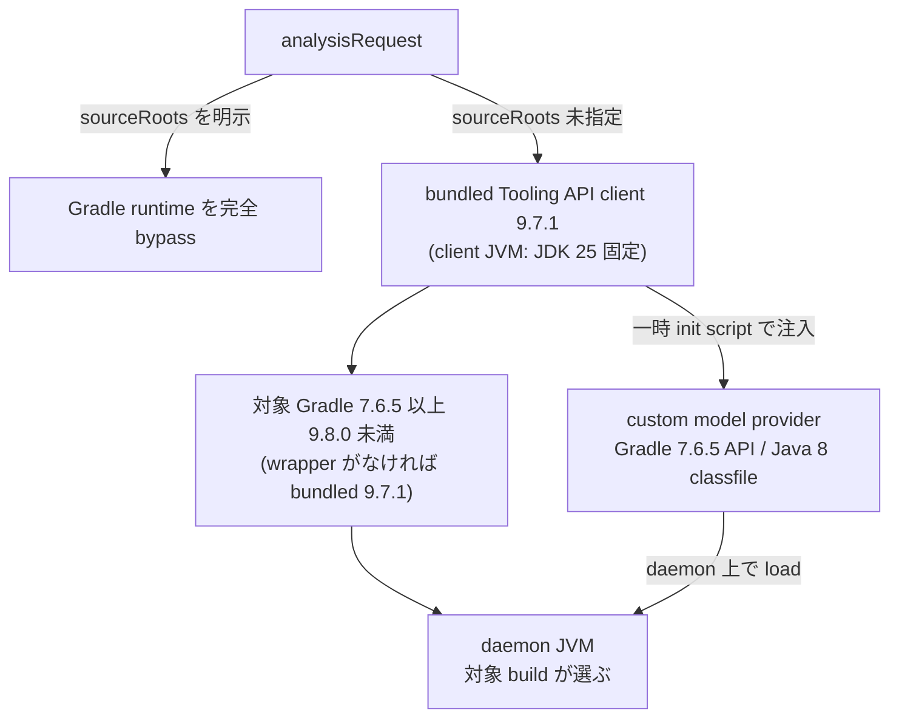

# Java Analyzer: Source root discovery

## Overview

discovery は、Java Analyzer が**解析の対象のソースと classpath をどう決めるか**を担う。  
利用者が `--source-root` を明示しない場合は、Gradle の build model へ問い合わせて、source root、compile classpath、classes output を得る。  
この方式は対象のプロジェクトの build logic を評価するため、network や credential provider に触れうる。  
その安全の境界も discovery が持つ。

Java Analyzer の全体と、この文書で使う語（classpath、classes directory、source root）は [Java Analyzer の Design Doc](../../../../../../../../DesignDoc.md) にある。  
ADR-0006: [Gradle Tooling API による source root の自動 discovery を採用する](../../../../../../../../../../adr/0006-adopt-gradle-tooling-api-discovery.md)

問い合わせには [Gradle Tooling API](https://docs.gradle.org/current/userguide/tooling_api.html) を使う。  
Gradle Tooling API は、外部のプログラムから Gradle に build を評価させ、project の階層、依存の関係、source のディレクトリを得る仕組みである。  
**build を評価する**ことが、安全の境界の話につながる。

## Scope

持つものは次のとおり。

- 利用者が `--source-root` を書かなかったときに、解析の対象のソースを見つける方法
- 型の解決に要る classpath を得る場所
- Gradle を呼ぶことで生じる副作用（build logic の評価）の扱い
- 対応する Gradle と JVM のバージョンの範囲と、範囲の外のときの失敗の分類

持たないものは次のとおり。

- 得た source root と classpath を使った型の解決。
  - [解析エンジンの文書](../analysis/DesignDoc.md) が持つ。
- request の metadata の key の一覧と合成の規則。
  - [Protocol への写像の文書](../protocol/DesignDoc.md#metadata-契約) が持つ。

## Design

### 方式の選び方と解析の context

`analysisRequest.sourceRoots` の有無で、方式を排他に選ぶ。

| 方式            | 入力                                                                                   | discovery と context                                                                                                            |
| --------------- | -------------------------------------------------------------------------------------- | ------------------------------------------------------------------------------------------------------------------------------- |
| 明示の override | `sourceRoots` を 1 件以上と `classpath` と `javaLanguageLevel`、要るなら `javaPreview` | Gradle の runtime を完全に bypass し、全 root と global の classpath から単一の synthetic な `SourceSetAnalysisContext` を作る  |
| 自動 discovery  | `sourceRoots` を指定しない                                                             | Gradle Tooling API で build model を得て、各 Gradle の project の `main` の source set ごとに `SourceSetAnalysisContext` を作る |

自動 discovery は、filesystem の convention や root module の include の記述を独自に解析しない。  
Gradle Tooling API `9.7.1` と、一時の init script から注入する同梱の custom model provider を使う。  
provider が返すのは、次の値だけである。

- project identifier
- `main` の source roots
- compile classpath
- classes output
- project dependencies
- 実効の source language level
- preview の有無

task の実行と source の生成は行わない。  
`test` と名前付きの source set は、明示の override で指定された場合を除いて、対象の外にする。  
一時の provider と init script は、workspace の外へ置く。

source language level は、compile の task の `release` を優先し、なければ実効の `sourceCompatibility` を使う。  
`targetCompatibility`、Analyzer の JVM、daemon の JVM、project の toolchain から parser の level を推測しない。

### Gradle と JVM の互換の範囲

Java と Gradle の version は、次の 4 つの軸に分ける。  
**軸をまたいだ推測と代用を禁止する。**

1. Analyzer の runtime の JDK: JDK 25 に固定する。
2. Gradle の daemon の JVM: 対象の Gradle の互換の条件で選ぶ。
3. 対象の project の compile の toolchain: 対象の project の build の定義が決める。
4. parser に渡す source language level と preview: 決め方は「方式の選び方と解析の context」の節にある。

自動 discovery の version の matrix は次のとおり。

- 同梱の Tooling API の client と、Analyzer の build の wrapper: `9.7.1`
- 対象の Gradle: `7.6.5 <= version < 9.8.0`
- wrapper がない build: 同梱の `9.7.1` を使う。
- custom provider: Gradle `7.6.5` の API を baseline にし、Java の `--release 8`、classfile の major 52 にする。
  - compile に使う再配布の API の artifact（`dev.gradleplugins:gradle-api`）は、`7.6.4` が最後のため、`7.6.4` に対して compile する。
  - patch release は public API を変えないため、`7.6.5` より新しい API の参照を混ぜない契約は、より強く満たされる。
- Analyzer の client の JVM: JDK 25 に固定する。
- daemon の JVM: 対象の build の wrapper と Gradle の設定が選び、Gradle の公式の Java の互換の matrix に従う。
  - depwalk は、JDK の download、同梱、自動の選択のどれも行わず、Analyzer の JDK 25 を古い Gradle の daemon へ強制しない。

次の図は、request から Gradle の daemon までの流れと、各段のバージョンを示す。

明示の `sourceRoots` の方式は、wrapper の判定、Tooling API、provider の load、daemon の matrix をすべて bypass する。

対応の範囲を変えるときの手順は [tech-stack.md の Upgrade Checks](../../../../../../../../../../context/tech-stack.md#upgrade-checks) にある。

### daemon の JVM の明示の指定

daemon の JVM は、対象の Gradle の互換の条件に従って選び、project の compile の toolchain や source language level とは別の軸で扱う。  
daemon の JVM が対象の Gradle の互換の範囲を外れることがある。例えば、Analyzer の JVM が daemon に引き継がれるときである。  
この場合は、request の `metadata.gradleJavaHome` で daemon の JVM を明示して指定できる。

- 値は要素 1 の path にし、CLI からは `--analyzer-meta gradleJavaHome=<path>` で渡す。
- 互換のある JDK を暗黙に自動で探さず、明示の override だけを受け付ける。
  - ADR-0009: [framework 由来の暗黙呼び出し解決と型伝播救済の設計判断](../../../../../../../../../../adr/0009-implicit-call-resolution-and-type-propagation-rescue.md)
- 指定の path が要素 1 の実在する java home（`bin/java`、Windows では `bin/java.exe` が実行できる directory）でなければ、`JAVA_INVALID_REQUEST` で拒否する。
- 明示の `sourceRoots` の方式では解釈しない。

### root の正規化と検証

root は、`/` で区切る workspace からの相対 path へ正規化する。  
正規化と検証の規則は次のとおり。

- 明示の root、または workspace の中の project の source set として採った root か file の realpath が、workspace の外へ出る場合は fatal にする。
- Tooling API が workspace の外の external の composite か included build として識別した build の project は、root の検証より先に、解析の scope から外す。
  - 外したことは、`JAVA_SOURCE_ROOT_EXCLUDED` の warning へ件数をまとめて報告する。
- root build の project の階層に含まれない composite と included build は、workspace の中のものも含めて、v1 の model の対象の外である。
  - provider が報告する build root ごとに、1 件の `JAVA_SOURCE_ROOT_EXCLUDED` の warning と、`--source-root` による明示の override の案内を出す。
  - 知らせずに抜け落ちることを残さないためである。
- model が返す解決済みの artifact は、外部の依存として使える。
- directory の symlink は再帰で追わない。
- 完全な重複は先勝ちで除く。
  - 一方が他方を包含する root は、request の曖昧さとして拒否する。
- 明示の root の欠落、directory でないこと、読み取れないことは fatal にする。
  - 自動 discovery で存在しない root は、生成の前の source とみなして外す。
- 最終の source file は、絶対の realpath で重複を除く。
- `include` と `exclude` と全 location は、常に `workspaceRoot` の座標で評価し、module と root の ID は graph に持ち込まない。

各自動の context は、model の project dependency で到達できる context と、自身の classpath だけを solver につなぐ。  
明示の方式は、synthetic な context の global の classpath を使う。  
location は source index から取り、solver の origin と dependency の到達性が一致するときだけ、別の context の source へ対応付ける。

### Gradle の runtime と安全の境界

自動 discovery は、利用者が信頼する Gradle の build logic を、利用者の権限で評価する。  
repository の認証、credential provider、network、Gradle の cache、daemon の JVM の選択は、Gradle に任せる。  
depwalk は、任意の build logic の副作用を sandbox に閉じ込めることを保証しない。  
明示の `sourceRoots` は、この runtime を完全に bypass する安全な方式である。

CLI の help は、この副作用の境界と明示の override を常に説明する。  
自動 discovery を始める各 run では、build を評価する前に、Analyzer の stderr へ安全の通知の定型文を出す。  
定型文は、run をまたいで同じ文面にする。  
定型文が伝える内容と非漏洩の境界は [operations.md の Environments](../../../../../../../../../../context/operations.md#environments) にある。

discovery の開始と終了、使った Gradle の version、project と root と除外した source set の件数、discovery の所要時間も stderr へ出す。  
失敗の安定した category は、stderr ではなく error record の message と metadata に載せる。  
Gradle から来た自由な文は出力しない。

Gradle の stdout と stderr は、Protocol と CLI の出力へ渡さずに捨てる。  
例外は、raw の message、URL の query、credential、絶対 path をそのまま返さず、分類した code と sanitize した message と detail に変える。  
非漏洩を保証する範囲は、depwalk が生成して渡す Protocol、CLI、log、test の artifact に限る。  
Gradle 自身と利用者の build logic の出力と副作用は含めない。

### discovery の失敗の reason

discovery の失敗は、どれも `JAVA_GRADLE_MODEL_ERROR` の fatal にし、次の 6 つの安定した reason で区別する。  
error record の metadata は、`reason` と、失敗した段階の `phase` を持つ。

| `reason`                     | `phase`         | 出る場面                                                                                       |
| ---------------------------- | --------------- | ---------------------------------------------------------------------------------------------- |
| `connection-failed`          | `connect`       | 対象の build の environment を Tooling API で読めない                                          |
| `unsupported-gradle-version` | `version-check` | Gradle の version が範囲の外か、version を判定できない custom distribution                     |
| `daemon-jvm-incompatible`    | `version-check` | daemon の JVM の version が互換の範囲の外か、判定できない                                      |
| `provider-incompatible`      | `model-request` | 同梱の provider を一時の directory へ用意できないか、provider が不完全な model を返した        |
| `model-request-failed`       | `model-request` | model の取得の Tooling API の呼び出しが失敗した。daemon の上での provider の load の失敗を含む |
| `no-java-source-roots`       | `model-request` | model の全 project を通じて、main の Java source root が 1 件もない                            |

daemon の上での provider の load の失敗は、原因を特定できないため、`model-request-failed` として報告する。  
ADR-0006: [source root を指定しない request では、Gradle Tooling API で build の実効 model から解析 context を discovery する](../../../../../../../../../../adr/0006-adopt-gradle-tooling-api-discovery.md)

model が source root を返した後に、除外と検証を経て有効な root が 0 件になった場合は、`JAVA_NO_SOURCE_ROOTS` の fatal にする。

## Interface

### 読む値

- `analysisRequest.sourceRoots`: 指定があれば明示の override の方式を、なければ自動 discovery の方式を選ぶ。
- `analysisRequest.metadata` の `classpath`、`javaLanguageLevel`、`javaPreview`、`gradleJavaHome`: 方式ごとの必須と禁止は [Protocol への写像の文書](../protocol/DesignDoc.md#metadata-契約) にある。

### 出す値

- stderr: 安全の通知の定型文、discovery の開始と終了、Gradle の version、project と root と除外した source set の件数、discovery の所要時間
- `JAVA_GRADLE_MODEL_ERROR` の error record の metadata: `reason` と `phase`
- `JAVA_SOURCE_ROOT_EXCLUDED`（warning）と、`JAVA_INVALID_SOURCE_ROOTS`、`JAVA_NO_SOURCE_ROOTS`、`JAVA_GRADLE_MODEL_ERROR`（fatal）
  - 意味は [Protocol への写像の文書](../protocol/DesignDoc.md#diagnostic--error-code-体系) にある。

### チェック

- `cd analyzers/java && ./gradlew gradleCompatibilityTest`: 下の Verification の anchor を確かめる。
  - `./gradlew test` は、tag `gradle-compat` のテストを除くため、この matrix を実行しない。

## Verification

Gradle と daemon の JVM の互換は、`analyzers/java/build.gradle.kts` の `gradleCompatibilityTest` の task が、次の 3 つの anchor で確かめる。

- Gradle `7.6.5` と daemon の JDK 8
  - この anchor は、`gradleJavaHome` の方式で daemon の JVM を固定し、override が `gradle.properties` と同じく働くことを確かめる。
- Gradle `8.14.5` と daemon の JDK 17
- Gradle `9.7.1` と daemon の JDK 25

anchor ごとに、同じ fixture に対して次を確かめる。

- provider を load できること
- model の field（project の数、source root、language level、project の依存）が一致すること
- task を実行しないこと
- 出力を隔離すること。
  - stderr は depwalk の固定の行だけである。

範囲の外の Gradle を実際の daemon で使ったときに、`unsupported-gradle-version` と明示の override の案内で失敗することも確かめる。  
daemon の JDK を用意する方法と、解決できないときに失敗させる契約は [testing.md の Runtime Requirements](../../../../../../../../../../context/testing.md#runtime-requirements) にある。
