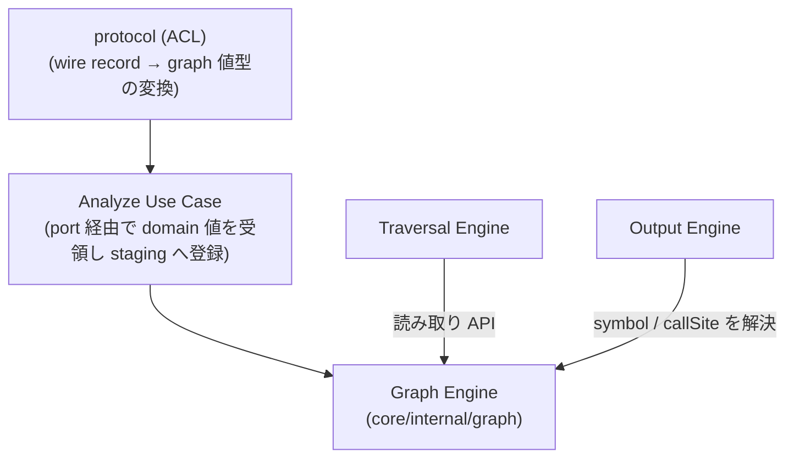
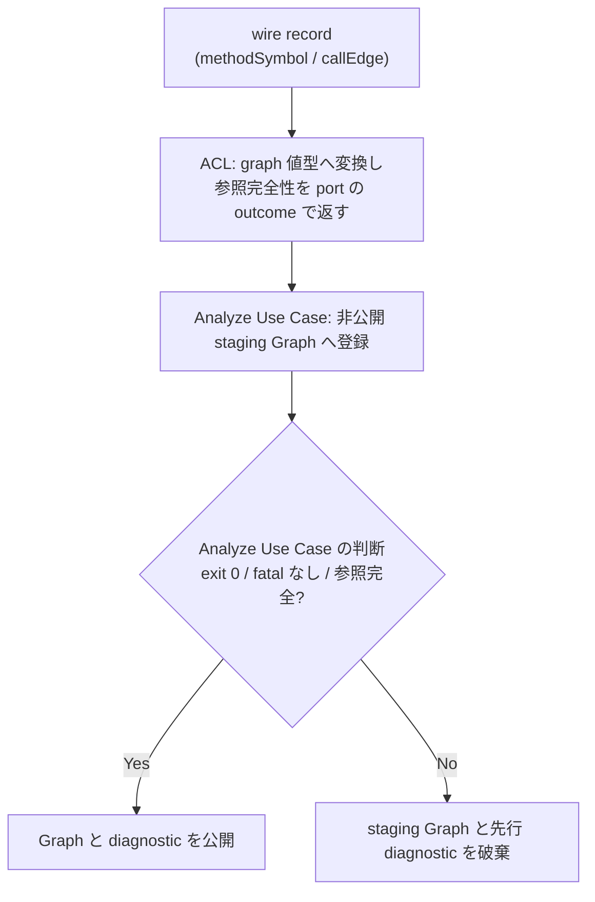

# Graph（呼び出しグラフのデータモデル）

## Overview

呼び出しグラフ（call graph）は、どのメソッドがどのメソッドを呼んでいるかを表す有向グラフである。

- node は、メソッド 1 つを表す。`com.example.UserService#findById(java.lang.Long)` のような単位である。
- edge は、呼び出し 1 つを表す。`A --> B` は、A が B を呼んでいることを表す。

このグラフがあると、あるメソッドを変えたときに誰が影響を受けるかに、edge を逆向きにたどるだけで機械的に答えられる。  
depwalk は Analyzer に解析させてこのグラフを作り、Graph Engine はその保持と読み取りを担う。  
探索は [Traversal の Design Doc](../traversal/DesignDoc.md) が持ち、全体の構成は [Design Doc](../../../design/DesignDoc.md#components) にある。

この文書は、次の 3 つを定める。

- in-memory の呼び出しグラフの node と edge が持つ属性（`Node.Symbol`、`Edge.CallSite`）
- Analyzer Protocol の wire の record（`methodSymbol`、`callEdge`）から graph の値型への変換
- staging Graph を公開する条件

変換と公開は `core/internal/protocol` と `core/internal/analyze` が実装するので、この文書の `governs` はその 2 つの package も含む。

## Scope

持つものは次のとおり。

- graph の node と edge が持つ表示のための属性（`Node.Symbol`、`Edge.CallSite`）
- Protocol の wire の record から graph の値型への変換の規則。変換する場所、回数、wire だけの field を除くこと
- staging Graph への登録と、公開と破棄の条件

持たないものは次のとおり。

- `MethodSymbol`、`CallEdge`、`SourceLocation` の wire の schema
  - [Analyzer Protocol の Design Doc](../protocol/DesignDoc.md) と ADR-0001 が持つ。
- 探索の意味
  - [Traversal の Design Doc](../traversal/DesignDoc.md) が持つ。
- 出力の形式ごとの表示の規則
  - 表示の規則と View への変換は [Output の Design Doc](../output/DesignDoc.md) が持つ。

## Design

### graph が属性を持つ理由

Analyzer Protocol の `methodSymbol` は、`methodId` のほかに `qualifiedName`、`signature`、`sourceLocation` を持つ。  
`callEdge` は `callSite` を持つ。  
一方で `methodId` は、Analyzer が決定的に生成する不透明な stable ID であり、人が読める名前である保証はない。  
field の定義は [Analyzer Protocol の Design Doc](../protocol/DesignDoc.md#methodsymbol) にある。

Output Engine が、メソッドの名前、宣言の位置、呼び出しの箇所を表示するには、graph の側がこれらの属性を持っている必要がある。  
graph の model は Output だけのものではなく、Traversal も読む横断のデータモデルなので、属性の契約はこの文書が定める。

### データ構造

graph は、node と edge の ID に加えて、表示に要る属性を graph に固有の値型として持つ。

```go
// core/internal/graph
type Node struct {
    ID     string // Analyzer の methodId (不透明な stable ID)
    Symbol Symbol
}

type Symbol struct {
    QualifiedName string
    Signature     string
    Source        *SourceLocation // 宣言位置 (optional。graph 固有の値型)
    Metadata      map[string]any  // Analyzer 固有情報 (opaque, optional)
}

type Edge struct {
    ID       string
    CallerID string
    CalleeID string
    CallSite *SourceLocation // 呼び出し箇所 (optional。graph 固有の値型)
    Metadata map[string]any  // Analyzer 固有情報 (opaque, optional)
}
```

- 変換は 1 回だけ行う。
  - `protocol.MethodSymbol` と `protocol.CallEdge`（wire の record）から上の値型への写しは、ACL（`protocol`。app が定める port の実装の側）が担う。
  - それより後、Core の中で wire の record を持ち回らない。
- wire だけの field（`schemaVersion`、`recordType`）は、graph の model に持ち込まない。
  - graph が wire の表現に結合すると、Protocol のバージョンの更新が Core の内部のモデルへ波及するためである。
- `SourceLocation` は graph の package が自前の値型として定め、`protocol` の package の型を再利用しない。
  - domain の層から wire の表現への import をなくすためである。wire の型との重複した定義は、境界を隔てるコストとして受け入れる。
  - ADR-0007: [Core と Java Analyzer の依存境界を ACL と機械のチェックで固定し、Core はフラットな package 構成のまま保つ](../../../adr/0007-layered-architecture-refactor.md)
- `sourceLocation` と `callSite` は Protocol で optional であり、graph でも nil を許す。
  - 表示のときに省く規則は、consumer である [Output の Design Doc](../output/DesignDoc.md) が定める。
- `methodSymbol.metadata` と `callEdge.metadata` は、入れ子の map と array を含めて deep copy する。
  - 写す先は、Graph が持つ opaque な属性（`Symbol.Metadata`、`Edge.Metadata`）である。
  - Graph と Traversal は、値の意味を解釈しない。
  - metadata を持たない record は nil、明示的に空の object を持つ record は空の map として、区別して持つ。この違いは JSON の出力に現れる。
  - JSON の出力へは opaque なまま透過で出す。出す規則は Output の Design Doc が定める。Console など、ほかの出力の表現には自動で出さない。
  - bytecode にだけある symbol のように、`sourceLocation` のない node も正しいものとする。owner の source の位置は metadata が持ち、`sourceLocation` と混同しない。

### 構築と公開の原子性

Analyze Use Case は、ACL が graph の値型へ変換した正しい `methodSymbol` と `callEdge` を、受け取った順に、request ごとの非公開の staging Graph へ登録する。  
wire の DTO の全件と、Analyzer の側の graph の全体は、別に buffer しない。  
staging Graph と diagnostic を公開するのは、次の 3 つがすべて揃ったときだけである。

- Analyzer が終了コード `0` で終わった。
- 致命的な record がない。
- stream の全体で、すべての edge の caller と callee の参照が揃った。

参照の完全性の確認と公開の判断は、担当が分かれる。

- stream の参照の完全性は、ACL（`protocol`）が確かめる。wire の record を見る責務であり、結果は port の outcome として返す。
- その結果とプロセスの状態から公開するかを決めるのは、Analyze Use Case である。
  - ADR-0007: [Core と Java Analyzer の依存境界を ACL と機械のチェックで固定し、Core はフラットな package 構成のまま保つ](../../../adr/0007-layered-architecture-refactor.md)

正しい `error`、非ゼロの終了、stdout の parse と schema のエラーのときは、参照の完全性を求めず、staging Graph と先に受け取った diagnostic をすべて捨てる。  
Graph Engine の公開の API から、request の部分的な結果は観測できない。

### コンポーネントの構成

次の図は、wire の record を受け取る ACL から、Graph を読む Traversal と Output までの L3 を示す。



- Traversal Engine は、Graph の読み取りの API で、node と edge の接続だけを見る。symbol の属性には依存しない。
- Output Engine は、Graph の読み取りの API で `Symbol` と `CallSite` を解決し、形式ごとの表示に使う。

### 構築の流れ

構築は、wire の record の受け取り、値型への変換、非公開の staging Graph への登録を、1 回の走査で行う。  
公開するのは、プロセスの成功と参照の完全性を確かめた後だけである。  
Protocol の詳しい検証は Analyzer Protocol の Design Doc が持つ。

次の図は、wire の record を受け取ってから Graph を公開するか捨てるかまでの流れを示す。



## Interface

### 置くファイル

- `core/internal/graph/graph.go`: `Node`、`Symbol`、`Edge`、`SourceLocation` と読み取りの API
- `core/internal/graph/graphtest/`: graph のテストを支える fixture の builder
- `core/internal/protocol/translate.go`: wire の record から graph の値型への変換
- `core/internal/analyze/analyze.go`: staging Graph への登録と、公開の判断

## Verification

テストの共通の規約は [context/testing.md](../../../context/testing.md#test-types-and-guarantees) にある。  
この機能に固有の観点は次のとおり。

- wire の record の `qualifiedName`、`signature`、`sourceLocation`、`metadata`、`callSite` が、変換した後の graph の値型に残ること。
  - 入れ子の metadata が deep copy されること。
- `sourceLocation` や `callSite` のない record からも、graph を作れること（nil を許す）。
- graph の model に `schemaVersion` と `recordType` が現れないこと。
- 正しい record を非公開の staging Graph へ逐次登録し、wire の DTO の全件を持たないこと。
- 成功のときだけ staging Graph を公開し、致命的な失敗と非ゼロの終了のときは、先に受け取った diagnostic とともに捨てること。
- 正常な stream では参照の完全性を検証し、致命的な stream では未完の参照を別の失敗にしないこと。
