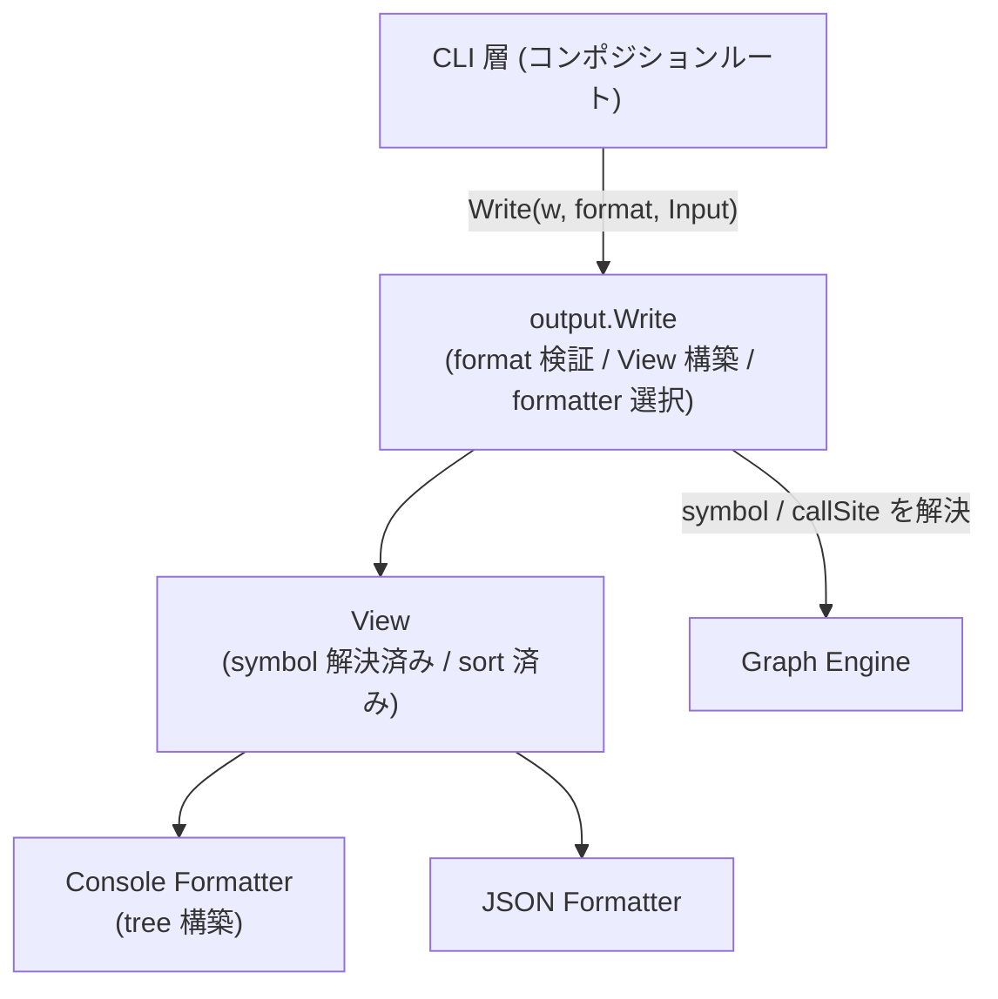
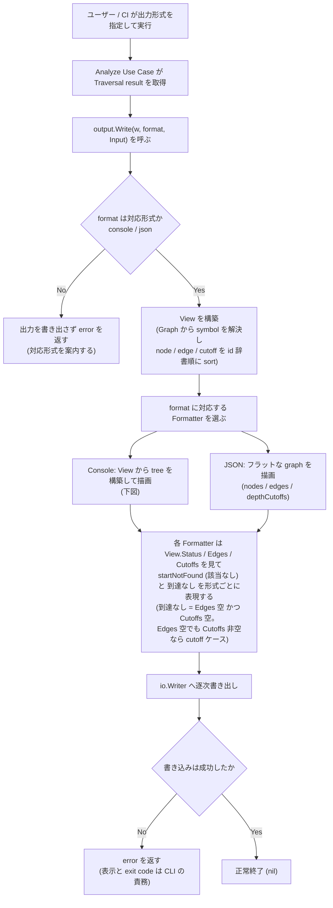
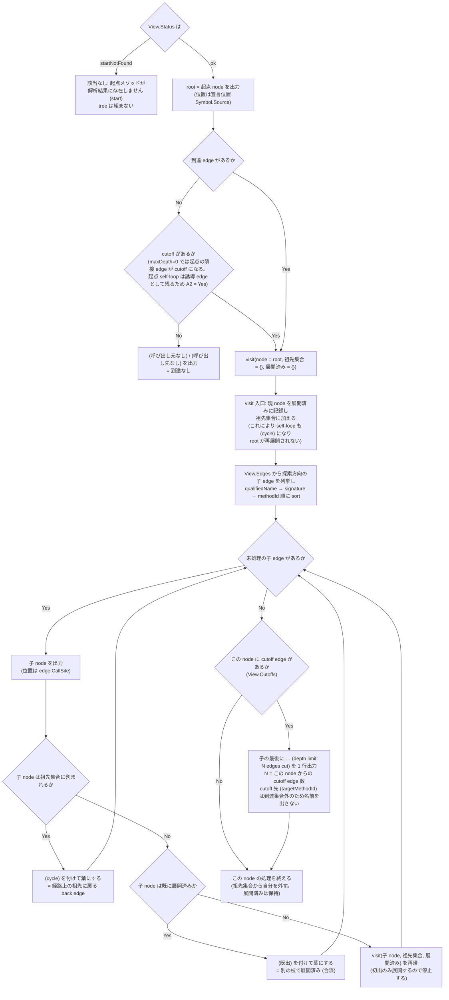
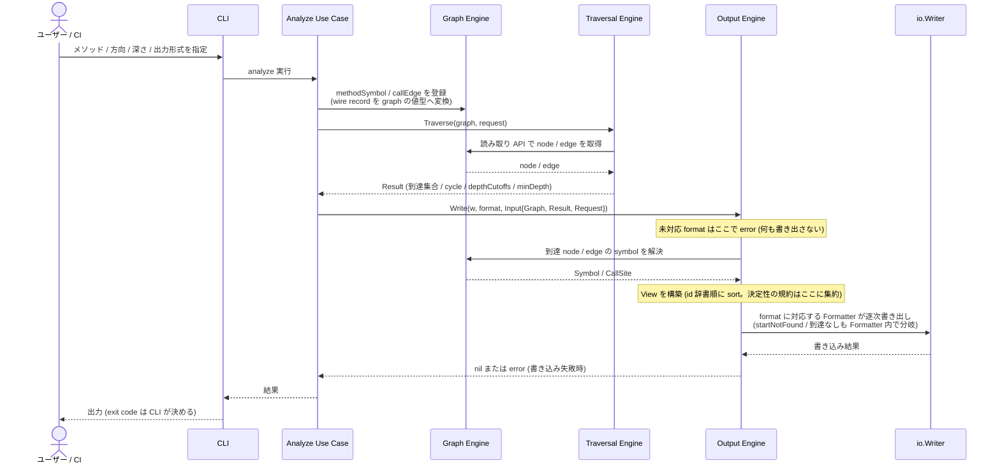

# Output（Console と JSON）

## Overview

Output Engine は、探索の結果の呼び出しグラフを、人が読む用途と機械で処理する用途の両方へ出す。  
形式を足すときに、Output Engine の構造を作り直さずに済むことを設計の目標にする。  
呼び出しグラフを Console と JSON で出力する成功条件は [PRD の Success Metrics](../../../PRD.md#success-metrics) にあり、全体の構成は [Design Doc](../../../design/DesignDoc.md#components) にある。

| 形式    | 何か                               | 誰が読むか               |
| ------- | ---------------------------------- | ------------------------ |
| Console | 端末にそのまま表示する tree の表現 | 人                       |
| JSON    | 機械で処理するための構造化データ   | スクリプトとほかのツール |

## Scope

持つものは次のとおり。

- Output の package の公開の entry point と、Formatter と View の構造
- Console の tree の表現（tree を組む規則、標識、行の書式）
- JSON の出力の schema、版の管理、後方互換の方針、要素の順序の決定性
- 該当なし、到達なし、未対応の format のエラーの境界

持たないものは次のとおり。

- グラフのビューワと、グラフを図として描く形式（DOT、Mermaid など）
  - ADR-0008: [可視化の出力（DOT / Mermaid）をスコープから外し、解析の精度と永続化を先に進める](../../../adr/0008-defer-graph-visualization.md)
- 探索の意味
  - [Traversal の Design Doc](../traversal/DesignDoc.md) が持つ。
- graph が持つ属性の定義
  - node と edge の属性と変換は [Graph の Design Doc](../graph/DesignDoc.md#データ構造) が持つ。
- CLI の引数の名前、終了コード、エラーの表示先。Output は `error` を返すところまでを担う。
  - flag と終了コードの判別は [CLI の Design Doc の責務の配置](../cli/DesignDoc.md#責務の配置) が持つ。

## Design

### 公開の entry point と Formatter と View

`output.Write` を、描画の唯一の entry point とする。  
`Write` は、format の検証、`View` の構築、formatter の選択、描画の 4 つを担う。  
呼び出す側は合成ルートである CLI の層で、formatter と `View` を知らずに、`Write` と `RegisteredFormats` だけを使う。  
formatter の interface は package の中に閉じ、公開しない。  
新しい形式の追加を、package の中の変更で済ませるためである。

`output.RegisteredFormats() []string` は公開する。  
CLI の層は、これを `--format` の許す値の検証と、エラーのメッセージでの一覧の表示に使う。  
CLI の側に許す値をハードコードしてはならない。  
formatter を registry へ登録するだけで、CLI へ自動で現れるようにする。

```go
// core/internal/output

type Format string

const (
    FormatConsole Format = "console"
    FormatJSON    Format = "json"
)

type Input struct {
    Graph   *graph.Graph
    Result  traversal.Result
    Request traversal.Request // direction / start を持つ (Result は保持しない)
}

// Write は Output package の唯一の公開 entry point。
//  1. f が未対応 format なら、何も書き出さずに error を返す
//  2. Input から View を構築する (symbol 解決 + sort)
//  3. f に対応する Formatter を選び、formatter.Format(w, view) を呼ぶ
func Write(w io.Writer, f Format, in Input) error

// 以下は package 内部の拡張点。

// 全 formatter が共有する中間表現 (symbol 解決済み / sort 済み)
type View struct {
    Status    traversal.Status
    Direction graph.Direction // 探索方向 (Request から引き継ぐ)
    Start     NodeView
    Nodes     []NodeView   // methodId の辞書順
    Edges     []EdgeView   // edgeId の辞書順。Cycle flag を持つ
    Cutoffs   []CutoffView // edgeId の辞書順
}

// NodeView は 1 node の Formatter 向け表現。symbol 欠落時は QualifiedName /
// Signature / Source がゼロ値 (ID のみ有効)。
type NodeView struct {
    ID            string
    QualifiedName string
    Signature     string
    Source        *graph.SourceLocation // nil なら位置情報なし
    MinDepth      int                      // 起点からの最短距離。Result の minDepth を View 構築時に引き継ぐ
    Metadata      map[string]any           // Analyzer 固有情報 (opaque, optional)。JSON のみ表出
}

// EdgeView は 1 edge の Formatter 向け表現。
type EdgeView struct {
    ID       string
    CallerID string
    CalleeID string
    Cycle    bool
    CallSite *graph.SourceLocation // nil なら位置情報なし
    Metadata map[string]any           // Analyzer 固有情報 (opaque, optional)。JSON のみ表出
}

// CutoffView は 1 depthLimit cutoff edge の Formatter 向け表現。
type CutoffView struct {
    EdgeID         string
    CallerID       string
    CalleeID       string
    TargetMethodID string                   // 探索方向の接続先 (dangling する側)
    TargetMinDepth int                      // TargetMethodID の minDepth
    CallSite       *graph.SourceLocation // nil なら位置情報なし
}

// formatter は package 内に閉じた interface (公開しない)。
type formatter interface {
    Format(w io.Writer, v View) error
}
```

- Formatter は `View` 以外に依存しない。
  - Console と JSON のどの出力の項目も、`View`、`NodeView`、`EdgeView`、`CutoffView` の field からだけ得る。`traversal.Result` と `graph.Graph` へ直接触れない。
  - すべての出力の項目と対応する field の一覧は、「View の境界の全数の対応」の節にある。
- 決定性の規約は、`View` の構築に 1 つにまとめる。
  - `Nodes`、`Edges`、`Cutoffs` を id の辞書順に固定し、同じ Result から常に同じバイト列を出す。
- symbol（`QualifiedName`、`Signature`、`Source`、`CallSite`）は、Graph の読み取りの API から解決する。
  - 属性の定義は Graph の Design Doc が持つ。`NodeView` は、symbol の欠落（ID だけ。`startNotFound` のときの起点など）を許す。
- `View` は、`Request` の `direction` と `start` を持って Formatter へ運ぶ。
  - `traversal.Result` がこの 2 つを持たないため、`Input` に `traversal.Request` を含める。JSON の `direction` と `start` の field と、Console の子の方向の判定と文言の分岐が必要とする。
- `NodeView.MinDepth` と `CutoffView.TargetMinDepth` は、`traversal.Result` が公開する `minDepth` を `View` の構築のときに引き継ぐ。
  - JSON の `nodes[].minDepth` と `depthCutoffs[].targetMinDepth` を、Formatter が `traversal.Result` に触れずに出せるようにするためである。
- 出力は `io.Writer` への逐次の書き出しで足り、専用の streaming の仕組みは入れない。
  - graph は全体がメモリの上にあり、出力の大きさは到達集合に比例する。

### View の境界の全数の対応

次の表は、Console と JSON の両方の Formatter が出すすべての項目と、対応する `View` の field である。  
Formatter は、この一覧に載る field 以外から情報を得ない。

| 出力項目                                                                       | View field                                                                  |
| ------------------------------------------------------------------------------ | --------------------------------------------------------------------------- |
| status                                                                         | `View.Status`                                                               |
| direction (Console の子方向判定 / JSON の `direction`)                         | `View.Direction`                                                            |
| 起点の methodId / qualifiedName / signature / 宣言位置 / entry point 標識      | `View.Start.ID` / `.QualifiedName` / `.Signature` / `.Source` / `.Metadata` |
| start (JSON)                                                                   | `View.Start.ID`                                                             |
| nodes[] の methodId / qualifiedName / signature                                | `View.Nodes[].ID` / `.QualifiedName` / `.Signature`                         |
| nodes[].minDepth                                                               | `View.Nodes[].MinDepth`                                                     |
| nodes[].sourceLocation                                                         | `View.Nodes[].Source`                                                       |
| nodes[].metadata (JSON は omitempty で全 key、Console は entry point 標識のみ) | `View.Nodes[].Metadata`                                                     |
| edge 両端 methodId (Console) / callerMethodId・calleeMethodId (JSON)           | `View.Edges[].CallerID` / `.CalleeID`                                       |
| edges[].edgeId                                                                 | `View.Edges[].ID`                                                           |
| edge の callSite (Console 子行の位置 / JSON `callSite`)                        | `View.Edges[].CallSite`                                                     |
| cycle flag                                                                     | `View.Edges[].Cycle`                                                        |
| edges[].metadata (JSON のみ、omitempty)                                        | `View.Edges[].Metadata`                                                     |
| cutoff の到達側 endpoint (Console) / callerMethodId・calleeMethodId (JSON)     | `View.Cutoffs[].CallerID` / `.CalleeID`                                     |
| cutoff 件数 (Console の `N edges cut`)                                         | `len(View.Cutoffs)` を対象 node 単位に集計                                  |
| depthCutoffs[].edgeId                                                          | `View.Cutoffs[].EdgeID`                                                     |
| depthCutoffs[].targetMethodId                                                  | `View.Cutoffs[].TargetMethodID`                                             |
| depthCutoffs[].targetMinDepth                                                  | `View.Cutoffs[].TargetMinDepth`                                             |
| depthCutoffs[].callSite                                                        | `View.Cutoffs[].CallSite`                                                   |

### エラーの境界

`startNotFound` と到達なしは、正常系として各形式で明示する。  
Output Engine が `error` を返すのは、未対応の format と書き込みの失敗の 2 つだけである。

| ケース                                                   | Console                                                                     | JSON                                             | 戻り値                                              |
| -------------------------------------------------------- | --------------------------------------------------------------------------- | ------------------------------------------------ | --------------------------------------------------- |
| 起点がない（`status=startNotFound`）                     | `該当なし: 起点メソッドが解析結果に存在しません (<start>)`                  | `status: "startNotFound"` と空の配列             | `nil`                                               |
| 到達なし（`Edges` も `Cutoffs` も空）                    | root の行と `└─ (呼び出し元なし)`（callee の方向は `(呼び出し先なし)`）     | 起点 1 件と空の `edges`                          | `nil`                                               |
| `Edges` は空で `Cutoffs` が空でない（`maxDepth=0` など） | root の行と `… (depth limit: N edges cut)`。`(呼び出し元なし)` とは出さない | 起点 1 件、空の `edges`、空でない `depthCutoffs` | `nil`                                               |
| 未対応の format の指定                                   | —                                                                           | —                                                | `error`（出力の前に検証し、対応する形式を案内する） |
| `io.Writer` への書き込みの失敗                           | —                                                                           | —                                                | `error`                                             |

- 到達なしの判定は、`Edges` が空で、かつ `Cutoffs` も空であることとする。
  - `maxDepth=0` では起点の隣の edge が cutoff になるため、`Edges` が空であることだけで判定してはならない。
  - このとき起点の self-loop は誘導 edge として残る。[Traversal の Design Doc](../traversal/DesignDoc.md#到達集合の定義) が定める `maxDepth=0` の契約による。
- 該当なしと到達なしの分岐は、各 Formatter の中で行う（`View.Status`、`Edges`、`Cutoffs` の 3 つを見る）。
  - 見せ方が形式ごとに違うため、`Write` は status で分岐しない。
- 終了コードとエラーの表示先は、CLI が持つ。

### Console の tree の表現

Traversal result は tree ではなく集合なので、tree にする規則を Output の側の仕様として定める。

#### tree を組む規則

1. root は起点の node とする。
2. 子は、誘導 edge 集合（`View.Edges`）を探索の方向にたどった先の node とする。caller の方向なら子は呼び出し元、callee の方向なら呼び出し先である。
3. 兄弟の順序は、`qualifiedName`、`signature`、`methodId` の辞書順とする。出力を決定的にするためである。
4. 展開の順序は、3 の順序の pre-order DFS とする。
   - node の展開に入るときに、その node 自身を展開済みとして記録し、たどっている途中の祖先の集合に加える（root を含む）。
   - こうすると self-loop も 6 の `(cycle)` になり、root の self-loop で root が再展開されることもない。
5. 部分木を展開するのは、tree の中で最初に現れたときの 1 回だけとする。
   - 出力の行数は O(到達 edge の数) に収まり、停止することはこの規則だけで保証される。
6. 展開しない葉には、再び現れた node の標識を 2 種類つける。
   - 判定は、Console の formatter が DFS の間に持つ祖先の集合で行う。
   - `Result.Cycles`（`View.Edges[].Cycle` として運ばれる）は使わない。この flag は同じ SCC の誘導 edge のすべてにつく、グラフの全体の性質である。打ち切りに使うと、3 要素の SCC で最初の edge が切られ、node が tree から消える。
   - `(cycle)` は、たどっている途中の祖先に戻る edge（back edge）の先につける。
   - `(既出)` は、祖先ではないが、別の枝で展開済みの node（合流）につける。
7. `… (depth limit: N edges cut)` は、cutoff の edge の到達の側の endpoint の子として、子の最後に 1 行出す。
   - N は、その node からの cutoff の edge の数である。
   - cutoff の先（`targetMethodId`）は到達集合の外なので、名前を出さない。
8. 到達なし（`Edges` も `Cutoffs` も空）のときは、root の行と `(呼び出し元なし)` か `(呼び出し先なし)` を出す。`Edges` が空でも `Cutoffs` が空でなければ、7 の cutoff の行を出す。
9. `startNotFound` のときは tree を組まず、エラーの境界の表のとおりの文言を出す。

#### 行の書式

- node のラベルは `signature` とする。
  - `signature` が欠けるときだけ `qualifiedName` へ、それも欠けるときは `methodId` へ fallback する。
  - Analyzer Protocol の `signature` は overload を区別する正規化した表現であり、Core は言語に固有の区切りの文字や引数の部分を解析しない。
- 位置の情報は、子の行では `edge.CallSite`（呼び出しの箇所）、root では宣言の位置（`Symbol.Source`）とする。
  - 欠けるときは位置の表記を省く。
  - メソッドの宣言の位置は、Console では出さない（JSON が両方を持つ）。
- node の `Metadata` に `entryPoint` の key があるときは、行の末尾に entry point の標識 `  (entry point: <simple 名をカンマ区切り>)` をつける。
  - 例は `  (entry point: @Scheduled)` である。
  - 位置は、`(cycle)` と `(既出)` の標識よりさらに後ろとする。key のない node には何も出さない。root の行にも同じ規則を当てる。
  - `entryPoint` の値は、検出したアノテーションの FQN を並べた string の配列で、その中身は Analyzer の側の Design Doc が定める。
  - simple 名は、`@` と FQN の最後の segment をつないだものとする。変換した後に重なる名前は 1 つに除き、変換の前の FQN の辞書順を保つ。
  - 表示の順は、Output の側で変換の前の FQN を辞書順に並べて決める。Analyzer の出力の順には依存しない。
  - Output が意味を解釈する metadata の key は、この `entryPoint` だけである。配列の中身も、simple 名への表示の変換のほかには解釈しない。

次の例は、合流、深さの打ち切り、循環を含む caller の方向の tree である。

```text
com.example.UserService#findById(java.lang.Long)  [UserService.java:42]
├─ com.example.UserController#getUser(java.lang.Long)  [UserController.java:31]
│  └─ com.example.ApiFilter#doFilter()  [ApiFilter.java:20]
├─ com.example.AdminController#getUser(java.lang.Long)  [AdminController.java:18]
│  └─ com.example.ApiFilter#doFilter()  (既出)
├─ com.example.UserBatch#execute()  [UserBatch.java:55]
│  └─ … (depth limit: 2 edges cut)
└─ com.example.CacheWarmer#warm()  [CacheWarmer.java:8]
   └─ com.example.Scheduler#run()  [Scheduler.java:12]
      └─ com.example.UserService#findById(java.lang.Long)  (cycle)
```

### JSON の出力

フラットな graph（`nodes[]`、`edges[]`、`depthCutoffs[]`）として出し、tree にはしない。  
field の名前は、Analyzer Protocol の語を踏襲する。

```json
{
  "schemaVersion": "1.0",
  "status": "ok",
  "direction": "caller",
  "start": "<methodId>",
  "nodes": [
    {
      "methodId": "<methodId>",
      "qualifiedName": "com.example.UserService.findById",
      "signature": "com.example.UserService#findById(java.lang.Long)",
      "minDepth": 0,
      "sourceLocation": {
        "path": "src/main/java/com/example/UserService.java",
        "startLine": 42
      }
    }
  ],
  "edges": [
    {
      "edgeId": "<edgeId>",
      "callerMethodId": "<methodId>",
      "calleeMethodId": "<methodId>",
      "cycle": false,
      "callSite": {
        "path": "src/main/java/com/example/UserController.java",
        "startLine": 31
      }
    }
  ],
  "depthCutoffs": [
    {
      "edgeId": "<edgeId>",
      "callerMethodId": "<methodId>",
      "calleeMethodId": "<methodId>",
      "targetMethodId": "<methodId>",
      "targetMinDepth": 3,
      "callSite": { "path": "...", "startLine": 12 }
    }
  ]
}
```

- `status` は `ok` か `startNotFound`、`direction` は `caller` か `callee` である。
- `edges[].cycle` は `Result.Cycles`（同じ SCC の誘導 edge）に対応し、false でも省かない。
- `nodes[].minDepth` は起点からの最短の距離である。定義は Traversal の Design Doc の `minDepth` にある。
- `sourceLocation` と `callSite` は、欠けるときは field ごと省く。
- `nodes[].metadata` と `edges[].metadata`（optional、additive）は、graph が持つ opaque な metadata を、意味を解釈せずにそのまま載せる。
  - 元の値は `Symbol.Metadata` と `Edge.Metadata` である。
  - 保持の規則は Graph の Design Doc が定める。欠けるとき（nil）は field ごと省く（omitempty）。
  - key の意味を定めるのは Analyzer の側の Design Doc であり、Output はその schema に依存しない。key の例は `resolution`、`provenance`、`declaringType`、`inherited` である。
  - Console へ人に向けて出す key は `entryPoint` だけとし、書式は行の書式の entry point の標識に従う。ほかの key は Console に出さない。
  - ADR-0009: [framework 由来の暗黙の呼び出しを Protocol の schema を変えずに metadata で表し、receiver の型は型根拠を保つ救済層で導く](../../../adr/0009-implicit-call-resolution-and-type-propagation-rescue.md)
- `depthCutoffs[].targetMethodId` は、探索の方向の接続先（dangling する側）である。
  - `direction=caller` なら `callerMethodId`、`callee` なら `calleeMethodId` と同じ値になる。
  - cutoff の先の node は到達集合の外なので、`nodes[]` にない。`targetMinDepth` は、この `targetMethodId` の `minDepth` である。
- 要素の順序は、`nodes[]` を `methodId`、`edges[]` と `depthCutoffs[]` を `edgeId` の辞書順に固定する。

#### 版の管理

- `schemaVersion` は、Analyzer Protocol とは別に採番する。
  - Protocol は Analyzer と Core の契約で、この schema は Core と利用者の契約であり、変える理由が別だからである。
- field の追加は後方互換（additive、minor）とする。削除、意味の変更、型の変更は互換を壊す変更（major）とする。
  - 利用者は、未知の field を無視できることを前提にする。

### コンポーネントの構成

次の図は、CLI から呼ばれる `output.Write` と、View、2 つの Formatter の L3 を示す。



### 出力の流れ

次の図は、出力の形式の指定から、format の検証、`View` の構築、formatter の選択を経て書き出すまでの流れを示す。



`startNotFound` と到達なしは、Formatter を迂回しない。  
該当なしの見せ方が形式ごとに違うため、各 Formatter が `View.Status`、`View.Edges`、`View.Cutoffs` を見て分岐する。

次の図は、Console の tree を組む流れを示す。  
停止することは、初出だけを展開する規則だけで保証され、`(cycle)` と `(既出)` は、なぜその枝を展開していないかを説明する表示にすぎない。



次の図は、Output が Graph から symbol を引き、`traversal.Result` と `Request` を入力にとる呼び出しの順を示す。



- 呼び出す側（CLI の層）は、use case が返した Traversal result と出力の形式を指定して `output.Write` を呼ぶ。未対応の format は、出力を書き出す前にエラーになる。
- 開発者と保守の担当は、Console の tree で呼び出しの関係を読む。合流は `(既出)`、循環は `(cycle)`、深さの上限は `… (depth limit: N edges cut)` で読み取れる。
- CI のパイプラインは JSON を保存して後で処理する。`minDepth == 1` で直接の呼び出し元だけを取り出すような処理が、JSON だけで済む。

## Interface

### 置くファイル

- `core/internal/output/output.go`: `Write`
- `core/internal/output/types.go`: `Format`、`Input`、`View`、`NodeView`、`EdgeView`、`CutoffView`
- `core/internal/output/view.go`: `View` の構築（symbol の解決と並べ替え）
- `core/internal/output/formatter.go`、`formatters.go`: formatter の interface、registry、`RegisteredFormats`
- `core/internal/output/console.go`: Console の formatter
- `core/internal/output/json.go`: JSON の formatter
- `core/internal/output/testdata/golden/`: formatter の出力の golden

## Verification

テストの共通の規約は [context/testing.md](../../../context/testing.md#test-types-and-guarantees) にある。  
この機能に固有の観点は次のとおり。

- 各 formatter の出力を golden file と比べる unit test で保証する。
  - golden の比較は、書式と決定性（同じ Result から同じバイト列）を同時に確かめる。
- fixture のケースは次のとおり。
  - 循環（self-loop、相互再帰、3 要素の SCC）
  - 合流（ダイヤモンド）
  - `depthLimit` cutoff
  - 到達なし（`Edges` も `Cutoffs` も空）
  - `maxDepth=0`（`Edges` が空で `Cutoffs` が空でない）
  - `maxDepth=0` と起点の self-loop
  - `startNotFound`
- Console は次を確かめる。
  - 3 要素の SCC で、すべての node が tree に現れること（`(cycle)` は back edge の先だけ）。
  - self-loop が `(既出)` でなく `(cycle)` になること。
  - root の self-loop で、部分木が二重に出ないこと。
  - `maxDepth=0` で `(呼び出し元なし)` を出さず、cutoff の行を出すこと。
  - 実際の Protocol と同じ完全な `signature` を入れても、`qualifiedName` と重ならず 1 回だけ表示され、`signature` が欠けるときの fallback が働くこと。
- JSON は次を確かめる。
  - `encoding/json` で parse できること。
  - `targetMethodId` が `nodes[]` にない（dangling）ことを、caller と callee の両方の方向で確かめること。
  - `cycle: false` が省かれないこと。
- エラーの境界では、未対応の format が出力を書き出す前に `error` になり、`startNotFound` と到達なしが `error` にならないことを確かめる。
- 出力の形式の成功条件は、Output の層（この文書の unit と golden）と、CLI の層の E2E の 2 層で確かめる。呼び出し元と呼び出し先の列挙と同じ分け方である。
