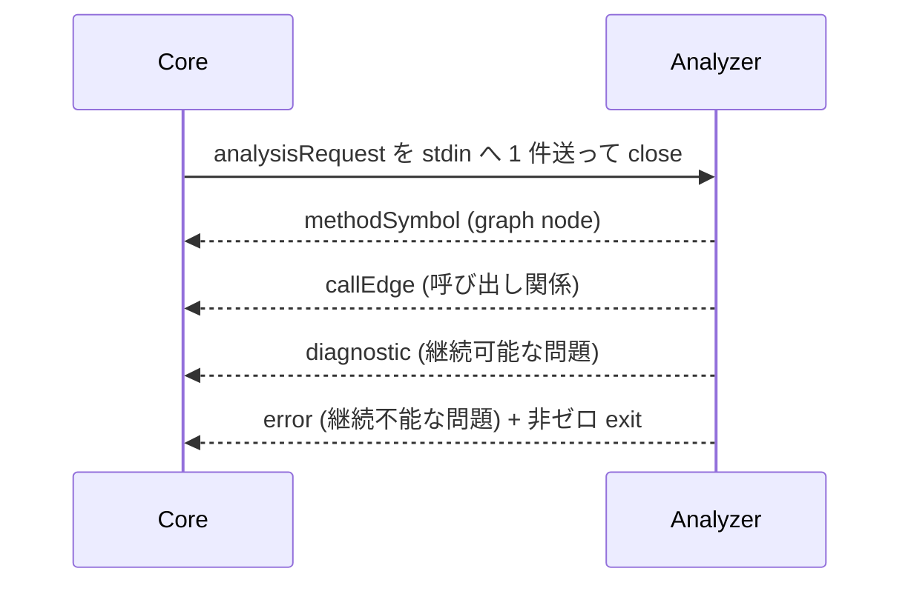
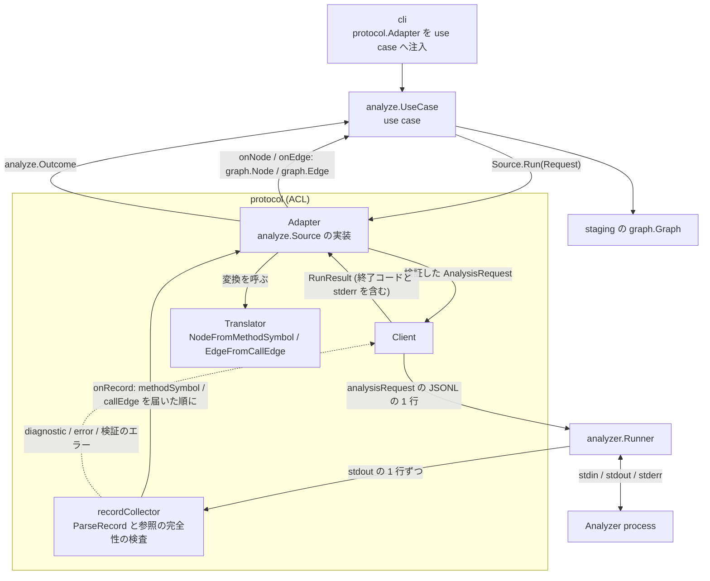
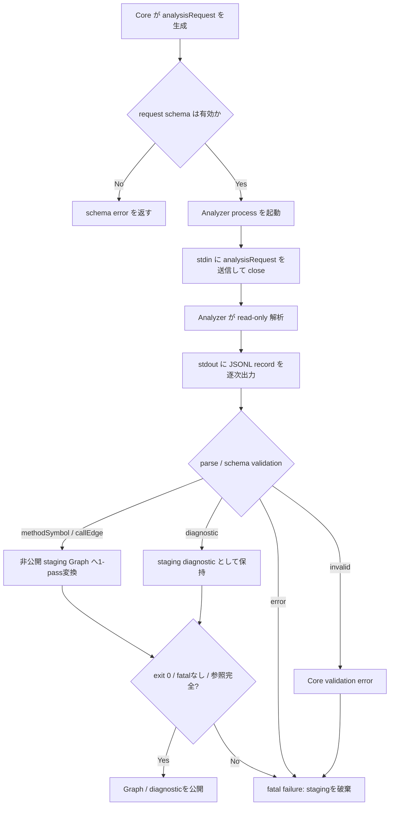

# Analyzer Protocol / SPI

## Overview

Analyzer Protocol / SPI は、Core と Analyzer をつなぐ Analyzer SPI、JSONL の Protocol、Model の schema を定める。  
Core と Analyzer の唯一の結合点であり、`MethodSymbol`、`CallEdge`、`SourceLocation`、`diagnostic`、`error`、プロセスの契約をここで定義する。  
Analyzer の実装者が従う共通の契約を提供し、新しい言語の Analyzer を足すときの Core の変更を `language` の値の追加に限る。  
成功条件は [PRD の Success Metrics](../../../PRD.md#success-metrics) にあり、全体の構成は [Design Doc](../../../design/DesignDoc.md#components) にある。  
ADR-0001: [Core と Analyzer を別プロセスにし、JSONL over STDIN/STDOUT の process SPI で結合する](../../../adr/0001-analyzer-protocol-jsonl-spi.md)

## Scope

持つものは次のとおり。

- Core から Analyzer へ渡す `analysisRequest` の record
- Analyzer から Core へ返す `methodSymbol`、`callEdge`、`diagnostic`、`error` の record
- `SourceLocation` の value object、`methodId` と `edgeId` の安定性、`metadata` の扱い
- Analyzer のプロセスの起動、stdin、stdout、stderr、終了コードの契約
- `schemaVersion`、未知の field、互換性を壊す変更の方針
- Protocol contract test で確かめる観点

持たないものは次のとおり。

- Java に固有の AST の解析、型の解決、DI の解決の方式
  - [Java Analyzer の Design Doc](../../../analyzers/java/DesignDoc.md) が持つ。
- Graph Engine、Traversal Engine、Output Engine の内部の構造
- 出力の表現
  - 表示の規則と View への変換は [Output の Design Doc](../output/DesignDoc.md) が持つ。
- Core の実装の言語、package manager、test framework
- Reflection、AspectJ の Runtime、実行時の Proxy の動的な解析
- capability の handshake と negotiation。1 つの request に 1 つのプロセスを起動する形に限る。
  - ADR-0001: [Core と Analyzer を別プロセスにし、JSONL over STDIN/STDOUT の process SPI で結合する](../../../adr/0001-analyzer-protocol-jsonl-spi.md)

## Design

### record の流れ

Protocol は STDIN と STDOUT の上の JSONL で、1 行を 1 record として扱う。  
すべての record は `schemaVersion` と `recordType` を必須の field に持つ。  
現行の `schemaVersion` は `"1"` である。

次の図は、Core と Analyzer の間を流れる record の向きを示す。

### analysisRequest

`analysisRequest` は、Core が Analyzer のプロセスを起動した後に stdin へ 1 件だけ送る解析の要求である。  
送った後、Core は stdin を close する。

| field           | 必須/任意 | 説明                                                                                           |
| --------------- | --------- | ---------------------------------------------------------------------------------------------- |
| `schemaVersion` | 必須      | Protocol のバージョン。現行は `"1"`                                                            |
| `recordType`    | 必須      | `analysisRequest`                                                                              |
| `requestId`     | 必須      | 解析の要求を識別する ID                                                                        |
| `workspaceRoot` | 必須      | 解析の対象の repository root                                                                   |
| `language`      | 必須      | 対象の言語。Core が許す値の一覧にある値。現行は `java` だけ                                    |
| `sourceRoots`   | 任意      | `workspaceRoot` からの相対の source root の配列。指定すると Analyzer の discovery を置き換える |
| `include`       | 任意      | `workspaceRoot` からの相対の path glob の配列                                                  |
| `exclude`       | 任意      | `workspaceRoot` からの相対の、除外する path glob の配列                                        |
| `entrypoints`   | 任意      | 起点の method selector の配列                                                                  |
| `analysisMode`  | 任意      | `fullGraph` または `reachableFromEntrypoints`。未指定のときは `fullGraph`                      |
| `metadata`      | 任意      | 言語や Analyzer に固有の hint。Core の共通の処理は依存しない                                   |

`include` と `exclude` は、`workspaceRoot` からの相対の path glob とする。  
path の区切りは `/` に正規化し、絶対 path、空文字、`..` を含む path は schema に従わないものとして扱う。  
対応する glob は `*`、`?`、`**` とする。

`sourceRoots` は、任意の明示の override である。  
未指定なら Analyzer が自身の標準の discovery を行い、1 件以上を指定すると discovery を完全に飛ばす。  
空の配列、空文字、絶対 path、`..` の segment は不正とし、`.` は workspace root そのものを表す。  
区切りは `/` に正規化する。

`workspaceRoot` は、`sourceRoots`、`include`、`exclude`、すべての `SourceLocation` に共通する唯一の座標系である。  
Protocol に module や root の ID は足さない。  
言語に固有の metadata の必須の条件と discovery の方式は、Analyzer ごとの Design Doc が定める。

`core/internal/protocol` は、`language` に許す値の一覧（`supportedLanguages`）を持つ。  
Core は、`analysisRequest.language` と `methodSymbol.language` が一覧にない record を invalid にする。  
新しい言語の Analyzer を足すときは、この一覧に値を 1 つ足す。  
Core のほかの package は変えない。  
ADR-0017: [2 つ目以降の言語の Analyzer を足すとき、Core の変更を protocol の許す language の値の追加に限る](../../../adr/0017-limit-core-change-to-language-value.md)

`entrypoints` の各要素は method selector の object とし、`qualifiedName` を必須、`signature` を任意にする。  
`entrypoints` が未指定か空の配列のとき、Analyzer は scope 全体の call graph の生成の要求として扱う。  
Core は、Protocol で array や object と定める field を、nil の slice や nil の map から `null` として出力しない。

### Analyzer から Core へ返す record

| record         | Core の対応 | 出現の条件                                                        |
| -------------- | ----------- | ----------------------------------------------------------------- |
| `methodSymbol` | 必須        | graph の node として扱う method、constructor、function を検出した |
| `callEdge`     | 必須        | 解決した caller と callee の呼び出し関係を検出した                |
| `diagnostic`   | 必須        | 未解決の symbol、部分的な解析、警告、致命的でないエラーがある     |
| `error`        | 必須        | 致命的なエラー。出力した後、Analyzer は非ゼロで終了する           |

「Core の対応が必須」は、Core の parser と validator がその record の種類を実装するという意味である。  
すべての解析の結果に、その record が 1 件以上出ることは意味しない。

### methodSymbol

| field            | 必須/任意 | 説明                                                        |
| ---------------- | --------- | ----------------------------------------------------------- |
| `schemaVersion`  | 必須      | Protocol のバージョン                                       |
| `recordType`     | 必須      | `methodSymbol`                                              |
| `methodId`       | 必須      | Analyzer が決定的に生成する stable ID                       |
| `language`       | 必須      | 対象の言語。Core が許す値の一覧にある値。現行は `java` だけ |
| `symbolKind`     | 必須      | `method`、`constructor`、`function`、`initializer`          |
| `qualifiedName`  | 必須      | 表示と debug のための完全修飾名                             |
| `signature`      | 必須      | overload を区別できる、正規化した signature                 |
| `sourceLocation` | 任意      | 定義の位置。位置を持てない symbol では省ける                |
| `metadata`       | 任意      | 言語に固有の情報。Core の graph の構築は依存しない          |

`methodId` は、次の条件が同じなら決定的に再生成できる ID とする。

- Analyzer の実装のバージョン
- `analysisRequest`
- source の内容
- `qualifiedName` と `signature`

Analyzer のバージョンをまたいで永続する ID は求めない。

bytecode にだけある symbol は、`sourceLocation` を省ける。  
source の owner との対応が要るなら、Analyzer に固有の metadata に持つ。  
graph の node と edge が metadata と `sourceLocation` を持つ境界は、[Graph の Design Doc のデータ構造](../graph/DesignDoc.md#データ構造) にある。

### callEdge

| field            | 必須/任意 | 説明                                                       |
| ---------------- | --------- | ---------------------------------------------------------- |
| `schemaVersion`  | 必須      | Protocol のバージョン                                      |
| `recordType`     | 必須      | `callEdge`                                                 |
| `edgeId`         | 必須      | Analyzer が決定的に生成する stable ID                      |
| `callerMethodId` | 必須      | 呼び出し元の `methodSymbol.methodId`                       |
| `calleeMethodId` | 必須      | 呼び出し先の `methodSymbol.methodId`                       |
| `callSite`       | 任意      | 呼び出し式の source の位置                                 |
| `metadata`       | 任意      | dispatch の種別、解析の confidence、言語に固有の call kind |

正しい `callEdge` は、`callerMethodId` と `calleeMethodId` が、解決した `methodSymbol` を指す。  
未解決の symbol は `diagnostic` で表す。

### metadata の透過

「Core の graph の構築は `metadata` に依存しない」は、Core が `metadata` の中身を解釈しないという意味である。  
利用者へ透過すると決めた metadata を捨ててよいという意味ではない。

- `callEdge.metadata` は、解決の根拠を載せる。Core の `graph.Edge` と `output.EdgeView` は、意味を解釈しない opaque な値として保持する。
- `methodSymbol.metadata` も同じく opaque な値である。Core は意味を解釈せず、Graph の `Symbol.Metadata` へ、入れ子の値を含めて deep copy する。
- Traversal は metadata を解釈せず、表に出さない。
- Output は、JSON の `nodes[].metadata` と `edges[].metadata`（optional、omitempty）として、意味を解釈せずに透過で出す。
- 唯一の例外は `methodSymbol.metadata` の `entryPoint` の key で、Console が表示のためにだけ意味を解釈する。
  - 表示の規則と例外の範囲は [Output の Design Doc](../output/DesignDoc.md#行の書式) が定める。
  - ADR-0009: [framework 由来の暗黙の呼び出しを Protocol の schema を変えずに metadata で表し、receiver の型は型根拠を保つ救済層で導く](../../../adr/0009-implicit-call-resolution-and-type-propagation-rescue.md)

### SourceLocation

`SourceLocation` は独立した JSONL の record ではない。  
`methodSymbol.sourceLocation` か `callEdge.callSite` に埋め込む value object とする。

| field         | 必須/任意 | 説明                              |
| ------------- | --------- | --------------------------------- |
| `path`        | 必須      | `workspaceRoot` からの相対の path |
| `startLine`   | 必須      | 1 から数える開始の行              |
| `startColumn` | 任意      | 1 から数える開始の column         |
| `endLine`     | 任意      | 1 から数える終了の行              |
| `endColumn`   | 任意      | 1 から数える終了の column         |

### diagnostic と error

`diagnostic` は、継続できる問題や部分的な解析の情報を表す。  
Core は利用者へ伝えるが、`diagnostic` だけを理由に解析の全体を致命的な失敗として扱わない。  
`diagnostic.severity` は `info`、`warning`、`partialFailure` のどれかとする。

`error` は、Analyzer が解析を続けられない致命的な問題を表す。  
Analyzer が `error` を出力したら、Analyzer のプロセスは非ゼロの終了コードで終わる。

| record       | 必須の field                                                 | 任意の field                                    |
| ------------ | ------------------------------------------------------------ | ----------------------------------------------- |
| `diagnostic` | `schemaVersion`、`recordType`、`severity`、`code`、`message` | `sourceLocation`、`relatedMethodId`、`metadata` |
| `error`      | `schemaVersion`、`recordType`、`code`、`message`             | `sourceLocation`、`details`、`metadata`         |

`error.details` は、Analyzer を問わず使える `FailureDetail` の配列である。  
各要素は `code` と `message` を必須、`sourceLocation` と opaque な `metadata` を任意とし、Analyzer が定める決定的な順で並べる。  
Core と CLI は、Analyzer に固有の code で分岐せず、共通の field を汎用に表示する。

不正な JSONL、schema に従わない record、未対応の `schemaVersion` は、Analyzer が表す `error` ではなく、Core の側の validation error として扱う。

### 致命的な失敗と公開の原子性

正しい `error` の record、非ゼロの終了、stdout の parse と schema のエラーは、どれも request の単位の致命的な失敗である。  
致命的な失敗は、それより前に受け取った graph の record と diagnostic を含め、成功の候補をすべて無効にする。  
致命的な失敗のときに保持してよい解析の結果は、共通の `error.details` に正規化した failure detail だけである。  
Core が record を staging Graph へ登録し、公開か破棄かを決める条件は [Graph の Design Doc の構築と公開の原子性](../graph/DesignDoc.md#構築と公開の原子性) にある。

### 異常終了のときの stderr

Analyzer の stderr は、Protocol の record として parse しない。  
ただし、Analyzer のプロセスが正しい `error` の record を出さずに異常終了したときに限り、Core は stderr の内容から診断のヒントを探してよい。  
たとえば `OutOfMemoryError` の pattern を検知して、heap を増やす対処を含むエラーを表示する。  
ヒントの抽出は終了した後のエラーの表示の補助であり、解析の結果の解釈と graph の構築には使わない。  
表示の文言と終了コードは [CLI の Design Doc の終了コード](../cli/DesignDoc.md#終了コード) にある。

### コンポーネントの構成

次の図は、use case が `analyze.Source` の port を通して、Analyzer のプロセスから graph の値と diagnostics を受け取るまでの L3 を示す。

`cli` は `protocol.Adapter` を `analyze.UseCase` へ注入し、use case は `analyze.Source` の port だけを知る。  
`analyzer.Runner` は JSONL の中身を解釈せず、Protocol の parse と検証は `protocol` だけが持つ。  
Core は、Analyzer の内部のライブラリと言語のランタイムに依存しない。

### 解析の流れ

次の図は、Core が要求を作ってから Graph を公開するか破棄するまでの流れを示す。  
公開の条件の規則は、Graph の Design Doc が持つ。

- Core は、CLI の入力を `analysisRequest` に正規化し、Analyzer のプロセスに 1 件だけ送る。
- Analyzer は `methodSymbol` と `callEdge` を stdout へ JSONL で逐次出力し、Core は逐次 parse と validate をする。
- Analyzer は未解決の symbol や部分的な解析を `diagnostic` として出し、Core は利用者が観測できるように伝える。
- Analyzer は続けられない問題を `error` として出し、非ゼロの終了コードで終わる。

### バージョンと互換性

`schemaVersion` は、record の種類ごとのバージョンではなく、Protocol の全体のバージョンを表す。  
record の受信者は、対応している major バージョンの record だけを受け付ける。  
対応していない major バージョンの record を受け取ったら、受信者は schema version mismatch として解析を失敗させる。  
ADR-0001: [Core と Analyzer を別プロセスにし、JSONL over STDIN/STDOUT の process SPI で結合する](../../../adr/0001-analyzer-protocol-jsonl-spi.md)

| 変更の種類                             | 互換性 | 扱い                                                                                  |
| -------------------------------------- | ------ | ------------------------------------------------------------------------------------- |
| record の最上位への任意の field の追加 | 互換   | 受信者は未知の field を無視し、既知の field だけで処理を続ける                        |
| 入れ子の object への field の追加      | 非互換 | Core は入れ子の object の未知の field を invalid にするので、major バージョンを上げる |
| `metadata` の中の追加                  | 互換   | 受信者は要る既知の field だけを使い、Core の graph の構築は `metadata` に依存しない   |
| 必須の field の追加                    | 非互換 | major バージョンを上げる                                                              |
| 必須の field の削除                    | 非互換 | major バージョンを上げる                                                              |
| field の型の変更                       | 非互換 | major バージョンを上げる                                                              |
| field の意味の変更                     | 非互換 | major バージョンを上げる                                                              |
| record の種類の削除                    | 非互換 | major バージョンを上げる                                                              |

入れ子の object は、`sourceLocation`、`callSite`、`details[]` の各要素とその `sourceLocation` を指す。  
Core は、これらの object の中で、field 名の大文字と小文字だけが違う key も未知の field として拒否する。  
`metadata` の中身は opaque な値なので、Core は中の field を確かめない。  
`entrypoints[]` は `analysisRequest` にだけあり、受信者の Analyzer は中の未知の field も無視する。  
Core の parser は `entrypoints[]` の各要素の未知の field も拒否するが、これは Core 自身の検証のためで、互換性の規則に含めない。  
ADR-0013: [Core は record の最上位の未知の field を無視し、入れ子の object の未知の field を invalid にする](../../../adr/0013-reject-unknown-nested-fields.md)

## Interface

### 置くファイル

- `core/internal/protocol/types.go`、`validate.go`、`parser.go`: record の型、検証、厳格な JSONL の parse
- `core/internal/protocol/client.go`: Analyzer を 1 回動かし、record を集めて参照の完全性を確かめる
- `core/internal/protocol/translate.go`: wire の record を graph の値へ変換する
- `core/internal/protocol/adapter.go`: `analyze` の port を実装する
- `core/internal/analyzer/runner.go`: プロセスの起動、stdin、stdout、stderr、終了コード
- `core/internal/analyze/source.go`: wire の表現に依存しない port
- `testdata/analyzer-protocol/records/valid/` と `records/invalid/`: contract test の record の fixture
- `testdata/analyzer-protocol/scenarios/`: プロセスの単位の scenario の fixture

## Verification

テストの共通の規約は [context/testing.md](../../../context/testing.md#test-types-and-guarantees) にある。  
この機能の contract test は、少なくとも次を確かめる。

- 正しい `analysisRequest` の record を Analyzer が受け取れること。
- `sourceRoots` の未指定と 1 件以上の指定を区別し、空の配列、絶対 path、空文字、`..` を拒否し、`.` を許すこと。
- `include` と `exclude` を相対の path glob として扱い、絶対 path、空文字、`..` を含む path を拒否すること。
- `entrypoints` の method selector を、`qualifiedName` を必須、`signature` を任意として検証すること。
- `entrypoints` が未指定か空の配列のとき、scope 全体の call graph の生成の要求として扱うこと。
- `analysisMode` が未指定のとき、`fullGraph` として扱うこと。
- Core が `analysisRequest` を送った後に stdin を close すること。
- Analyzer の stdout の JSONL の record を、逐次 parse し validate すること。
- Analyzer の stdout に invalid UTF-8 を含む JSONL の record が出たとき、Core が invalid record として拒否すること。
- Analyzer の stdout に duplicate key を含む JSON の object が出たとき、Core が invalid record として拒否すること。
- Protocol の field 名の大小文字の違いを別の field として扱い、`schemaVersion` の代わりに `schemaversion` が出たら必須の field の欠落として拒否すること。
- Protocol で array や object と定める field を Core が出力するとき、nil の slice や nil の map に由来する `null` を出さないこと。
- Analyzer の stderr を Protocol の record として parse しないこと。
- 終了コード `0` を成功、非ゼロを致命的な失敗として扱うこと。
- 複数の request が要るとき、Core が request ごとに Analyzer のプロセスを起動すること。
- `methodSymbol` と `callEdge` が 0 件の正常な解析を成功として扱えること。
- `methodId` と `edgeId` を、同じ条件で決定的に再生成すること。
- `schemaVersion` を、Protocol の全体のバージョンとして、すべての record に必須とすること。
- Analyzer が `analysisRequest` の未知の field を無視できること。
- Core が Analyzer の応答の record の最上位の未知の field を無視できること。
- Core が、入れ子の object の中の未知の field と、大文字と小文字だけが違う field 名を、invalid record として拒否すること。
- 対応していない major バージョンの record を、Core が schema version mismatch として拒否できること。
- 必須の field の削除、型の変更、意味の変更を、非互換の変更として検出できること。
- 正しい `diagnostic` を Core が利用者へ伝え、`diagnostic` だけを理由に致命的な失敗にしないこと。
- 正しい `error` を Core が致命的な失敗として扱うこと。
- Analyzer が `error` の record を出した後に、非ゼロの終了コードで終わること。
- `error.details` を決定的な順で保持し、Core と CLI が Analyzer に固有の code に依存せずに表示できること。
- 致命的な失敗と非ゼロの終了で、先に受け取った graph の record と diagnostic を破棄し、成功のときだけ staging Graph を公開すること。
- 未解決の symbol を `diagnostic` で表し、未解決の callee を指す `callEdge` を正しい edge として扱わないこと。
- 正しい `methodSymbol` と `callEdge` の record と、埋め込まれた `SourceLocation` の value object を、Core が parse し validate できること。
- Java に固有の情報を `metadata` に持つ record でも、Core が意味を解釈せず、Graph の Symbol と Edge へ入れ子の値を deep copy できること。
  - Traversal は表に出さず、Output は JSON の `nodes[].metadata` と `edges[].metadata`（optional、omitempty）として意味を解釈せずに透過で出す。
