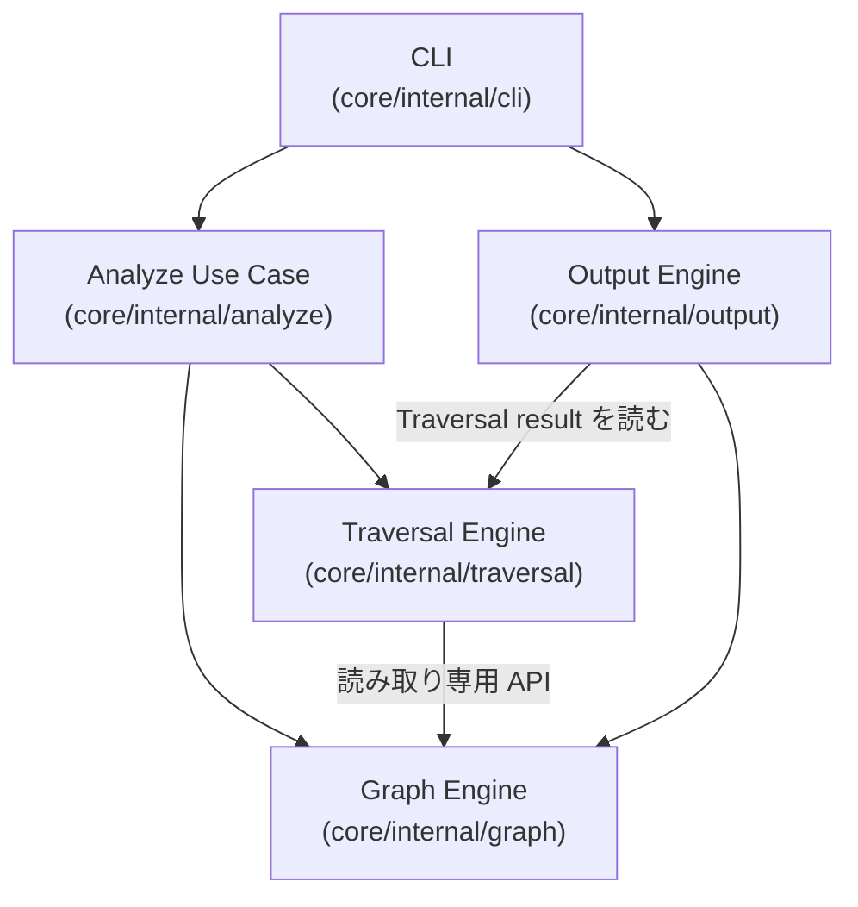
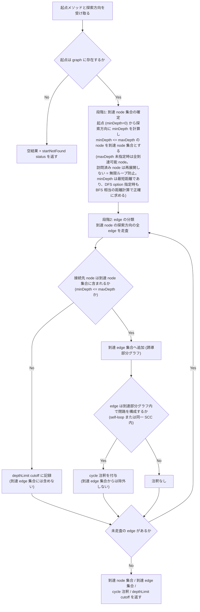
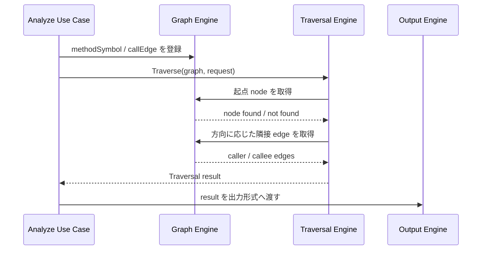

# Traversal（Caller / Callee の探索）

## Overview

探索は、[Graph Engine](../graph/DesignDoc.md) が持つ呼び出しグラフを、起点のメソッドから edge をたどって、関係するメソッドを集める処理である。  
方向は 2 つある。

- caller の方向は、このメソッドを呼んでいるのは誰かをさかのぼる。変更の影響の範囲を知りたいときに使う。
- callee の方向は、このメソッドが何を呼んでいるかを下る。処理の流れを追いたいときに使う。

どちらも 1 段で止めずに再帰的にたどるため、A を変えると最終的に誰が影響を受けるかが分かる。  
ただし呼び出しは循環しうる。  
A が B を呼び、B が A を呼ぶとき、無限にたどらないための打ち切りが要る。

この文書は、Graph Engine が持つ node と edge を入力に、探索の API、結果のモデル、打ち切りの意味を定める。  
結果のモデルの契約は、到達 node 集合、到達 edge 集合、`cycle` 注釈、`depthLimit` cutoff の 4 つである。  
呼び出し元と呼び出し先を網羅的に列挙する成功条件は [PRD の Success Metrics](../../../PRD.md#success-metrics) にあり、全体の構成は [Design Doc](../../../design/DesignDoc.md#components) にある。

## Scope

持つものは次のとおり。

- caller の方向と callee の方向の探索の API
- 探索の方向、起点のメソッド、深さの上限、探索順序（BFS か DFS）の受け取り
  - 探索順序は受け取って検証するだけで、結果にも探索の実行にも影響しない。
- 循環する呼び出しと再帰の検出。無限ループせず、観測できる形で結果に含める。
- 深さの上限に達したことの検出。打ち切りの情報を結果に含める。
- Graph Engine が公開する読み取りの API を通した探索。Graph の内部の構造に依存しない。

持たないものは次のとおり。

- Java のソースの解析、型の解決、DI の解決
  - [Java Analyzer の Design Doc](../../../analyzers/java/DesignDoc.md) が持つ。
- Analyzer Protocol、SPI、Model の schema
  - [Analyzer Protocol の Design Doc](../protocol/DesignDoc.md) が持つ。
- Output Engine の表現の形式
  - Console と JSON の表示の規則は [Output の Design Doc](../output/DesignDoc.md) が持つ。
- CLI の `depwalk analyze` の引数、終了コード、エラーの表示
  - flag と終了コードの判別は [CLI の Design Doc の責務の配置](../cli/DesignDoc.md#責務の配置) が持つ。
- 永続的なストア、キャッシュ、並列の探索、分散の処理

## Design

### request と result

Traversal は、起点の method ID、方向（`caller` か `callee`）、深さの上限（任意）、探索順序（`bfs` か `dfs`。未指定のときは `bfs`）を受け取る。  
返すのは、到達 node 集合、到達 edge 集合、status、`cycle` 注釈、`depthLimit` cutoff である。

| 概念              | 主な field と値                                                                                                                       | 備考                                                                                                                                          |
| ----------------- | ------------------------------------------------------------------------------------------------------------------------------------- | --------------------------------------------------------------------------------------------------------------------------------------------- |
| Traversal request | 起点の method ID、方向、深さの上限（任意。未指定のときは無制限）、探索順序（未指定のときは `bfs`）                                    | CLI の引数の名前は [CLI の Design Doc](../cli/DesignDoc.md) が定める                                                                          |
| Traversal result  | 到達 node 集合（node ごとの `minDepth` を持つ）、到達 edge 集合、status（`ok` か `startNotFound`）、`cycle` 注釈、`depthLimit` cutoff | consumer は Output Engine。tree は持たない。到達 node 集合と到達 edge 集合は順序を保証しない                                                  |
| Cycle 注釈        | 対象の edge の集合                                                                                                                    | 到達部分グラフの中で閉路をなす edge（self-loop か、同じ SCC の中の edge）。到達 edge 集合にも含む。呼び出しの関係として実在するため除かない   |
| DepthLimit cutoff | 対象の edge の集合、接続先の node の `minDepth`                                                                                       | 到達 node から `minDepth > maxDepth` の node への edge。到達 edge 集合には含めない。対象は edge だけで、node そのものは cutoff の対象にしない |

### 到達集合の定義

結果は、探索の副産物（どの edge をたどったか）ではなく、グラフの性質として定める。  
こうすると、結果は探索順序（BFS か DFS）にまったく依存せず、決定的になる。

- `minDepth`: 起点から探索の方向に沿った最短の距離。起点そのものは 0 である。
  - 合流（複数のたどり方で同じ node に着くダイヤモンド型の構造）があるときは、最短の距離をとる。
  - Traversal result は、到達 node ごとの `minDepth` を公開する。consumer の JSON の出力が使う。
  - 公開する値は、到達の判定に使う内部の値と同じであり、到達集合、`cycle`、`depthLimit` の意味には影響しない。
- 到達 node 集合: `minDepth <= maxDepth` を満たす node。`maxDepth` が未指定のときは、到達できるすべての node。起点を含む。
- 到達 edge 集合: 両端が到達 node 集合に属する、探索の方向に沿ったすべての edge（誘導部分グラフ）。合流の edge も、`cycle` 注釈のある edge も含む。
- `maxDepth=0`: 起点の node だけを到達集合に含め、起点の隣の edge は `depthLimit` cutoff になる。
  - ただし起点そのものへの self-loop は、両端が到達 node なので、誘導 edge（と `cycle` 注釈）として到達 edge 集合に残る。誘導部分グラフの定義から導かれる。

呼び出しグラフでは、共有のメソッドが複数の箇所から呼ばれる合流の構造がふつうにある。  
誘導部分グラフと SCC の判定で定めると、合流の構造でも、探索順序で結果の edge が変わらず、循環していない合流の edge を循環と誤って標識しない。  
ADR-0010: [Traversal の結果を誘導部分グラフと SCC の判定で定める](../../../adr/0010-traversal-induced-subgraph.md)

訪問済みの node の管理（再展開の抑止）は、無限ループを防ぐ内部の実装の仕組みであり、結果の契約には現れない。

### 探索順序の扱い

探索順序（`bfs` か `dfs`）は request が受け取るが、探索の実行にも結果にも影響しない。  
到達集合はグラフの性質として定めてあり、その計算には最短の距離の走査が 1 本あれば足りるためである。  
順序の指定は、値として正しいかだけを検証し、不正なら error にする。

BFS と DFS の走査そのものは実装にあるが、本番のコードのどこからも呼ばない。  
Console の tree の出力のように、順序のある展開を要する consumer が現れたときのために残してある。

順序を変えても結果が同じであることは、2 通りの走査を比べた結果ではなく、走査が 1 本しかないことから従う。

### コンポーネントの構成

次の図は、Traversal Engine と、それを呼ぶ use case、それを読む Output の L3 を示す。

Traversal Engine は `core/internal/traversal` に閉じ、Graph の node と edge の管理には関わらない。  
Graph が公開する読み取りの API を通してだけ探索する。  
Analyzer に固有の情報や Java に固有の metadata を、分岐の条件にしない。  
package の依存の規則は [context/codebase.md](../../../context/codebase.md#dependency-rules) にある。

### 探索の流れ

処理は、到達 node 集合を決める段階と、誘導 edge 集合と注釈を作る段階の 2 つで行う。  
1 つ目の段階の訪問の順序（BFS か DFS）は、結果に影響しない。

次の図は、起点を受け取ってから 4 つの結果を返すまでの流れを示す。

次の図は、use case が Graph を作ってから Traversal の結果を Output へ渡すまでの呼び出しの順を示す。

- 呼び出す側は、起点のメソッド、探索の方向、深さの上限、探索順序を指定して Traversal Engine を呼ぶ。探索順序が未指定なら BFS、深さの上限が未指定なら無制限として扱う。
- 起点のメソッドが graph にないとき、Traversal Engine は空の到達集合と `startNotFound` の status を返す。Graph が空のときも同じく `startNotFound` として扱う。
- Output Engine は Traversal の結果を受け取り、Console と JSON へ変換する。Console の tree が要るときも、tree は Output の側で組み、Traversal は tree の表現を持たない。

## Interface

### 置くファイル

- `core/internal/traversal/traversal.go`: request と result の型、`Traverse`、request の検証
- `core/internal/traversal/search.go`: 最短の距離の走査と、BFS と DFS の走査
- `core/internal/traversal/result.go`: 到達 edge 集合、`cycle` 注釈、`depthLimit` cutoff の構築
- `core/internal/traversal/scc.go`: `cycle` 注釈のための SCC の判定

## Verification

テストの共通の規約は [context/testing.md](../../../context/testing.md#test-types-and-guarantees) にある。  
この機能に固有の観点は次のとおり。

- caller と callee の方向で、既知の呼び出し元と呼び出し先の集合を返せること。
- 探索順序の走査そのものが、未指定のとき BFS、`dfs` を指定したとき DFS の訪問順を返すこと。
  - 本番のコードからは呼ばないため、white-box のテストで確かめる。
- 不正な request（未知の探索の方向、負の深さの上限、未知の探索順序）が、探索を実行せずに error になること。
- 自己再帰と相互再帰（SCC）を含む graph で、閉路をなす edge が `cycle` 注釈を持ち、到達 edge 集合にも含まれること。
- 合流（ダイヤモンド型）の graph で、同じ node へ向かう複数の edge がすべて到達 edge 集合に含まれ、`cycle` と誤って標識されないこと。
- BFS と DFS のどちらを指定しても、到達 node 集合、到達 edge 集合、`cycle` 注釈、`depthLimit` cutoff の内容が同じであること（順序に依存しないこと）。
- 深さの上限を指定したとき、`minDepth <= maxDepth` の node を到達集合に含め、`minDepth > maxDepth` の node への edge を `depthLimit` cutoff として記録できること。
  - `maxDepth=0` で、起点への self-loop が誘導 edge と `cycle` 注釈として残る境界のケースを含む。
- 両端が `maxDepth` ちょうどの到達 node を結ぶ、frontier の間の cross edge（探索木の edge でないもの）が、誘導 edge として到達 edge 集合に含まれること。
- 到達 node ごとに公開する `minDepth` が、起点からの最短の距離に一致すること。合流の graph では、短いほうのたどり方の値をとること。
- 起点のメソッドがないときと Graph が空のときに、panic せず、空の結果と `startNotFound` の status を返すこと。
- Traversal が Analyzer の実装と Output の形式に依存しないこと。
