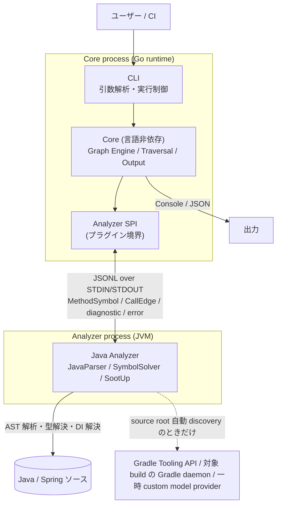
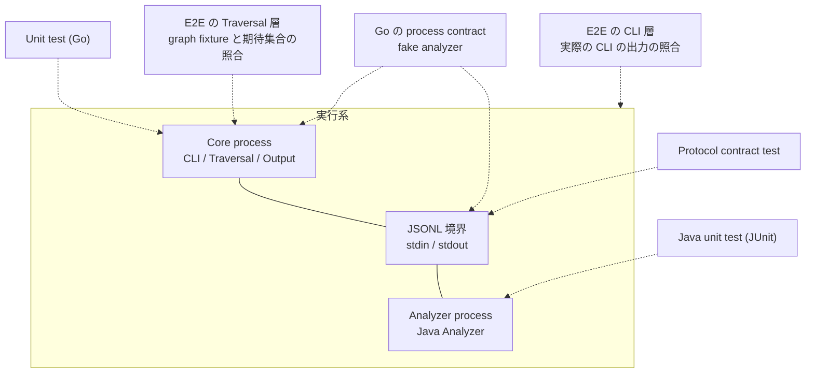

# depwalk Design Doc

## Overview

depwalk は、静的解析でメソッド間の呼び出し関係を抽出し、変更の影響範囲の調査を支援する CLI である。  
開発者と CI のパイプラインが使う。  
誰のどの課題を解くかは [PRD](../PRD.md) にある。

言語ごとの解析の差は、独立したプロセスの Analyzer に閉じ込める。  
呼び出しグラフの構築、探索、出力を担う Core は、言語に依存させない。  
この分離により、Kotlin、TypeScript、Vue、Go の解析を足すとき、Core では `core/internal/protocol` の許す `language` の値を 1 つ足すだけで済む。

- ADR-0001: [Core と Analyzer を別プロセスにし、JSONL over STDIN/STDOUT の process SPI で結合する](../adr/0001-analyzer-protocol-jsonl-spi.md)
- ADR-0017: [2 つ目以降の言語の Analyzer を足すとき、Core の変更を protocol の許す language の値の追加に限る](../adr/0017-limit-core-change-to-language-value.md)

Core は Go で実装し、Go modules と Go の標準のコマンドで build する。  
ADR-0002: [Core を Go と Go modules で実装し、依存を Cobra と標準ライブラリに絞る](../adr/0002-core-implementation-foundation.md)

## Goals and Non-Goals

### Goals

- 呼び出しグラフの構築、caller と callee の探索、Console と JSON の出力を、言語に依存しない Core で提供する。
- 言語ごとの解析を Analyzer のプロセスに閉じ、Core とは Protocol だけで結合する。
- Java と Spring Boot の解析では、Spring の DI を経由する呼び出し先を実体まで解決する。
  - ADR-0005: [Java Analyzer に SootUp による型階層の補完と Spring DI の解決を 1 つの feature として導入する](../adr/0005-adopt-sootup-and-spring-di-resolution.md)

### Non-Goals

- 実行時の情報に依存する解析。Runtime Trace と APM の計測、Reflection、AspectJ の Runtime、実行時の Proxy の解析を持たない。
  - ADR-0004: [動的呼び出しの完全追跡を初期スコープに含めず、候補と未解決理由を観測可能にする](../adr/0004-defer-runtime-call-tracing.md)
- IDE の Plugin と Web UI。提供の形は CLI に限る。
- グラフの可視化の出力。
  - ADR-0008: [可視化の出力（DOT / Mermaid）をスコープから外し、解析の精度と永続化を先に進める](../adr/0008-defer-graph-visualization.md)

## Assumptions and Constraints

- 解析は静的解析で行い、実行時の情報には依存しない。
- 対象は JVM の言語を先行させ、まず Java と Spring Boot を扱う。Kotlin、TypeScript、Vue、Go は将来の対象である。
- 言語ごとの解析は、その言語のランタイムの上で動く独立した Analyzer のプロセスが担う。Core は特定の言語のランタイムに依存しない。
- Core と Analyzer は、Protocol の record（`analysisRequest`、`MethodSymbol`、`CallEdge`、`diagnostic`、`error`）と、Analyzer の終了コードを介して結合する。
- Gradle のランタイムは、Java Analyzer が source root を自動で discovery するときだけ使う、条件つきの依存である。
  - 自動 discovery を使う場合も、Core と Analyzer Protocol の言語非依存の境界は変わらず、成功の条件にも影響しない。
  - 動くものと副作用の前提は [context/operations.md の Environments](../context/operations.md#environments) にある。
  - ADR-0006: [source root を指定しない request では、Gradle Tooling API で build の実効 model から解析 context を discovery する](../adr/0006-adopt-gradle-tooling-api-discovery.md)

## Architecture

誰が何のために使うかの L1 の図は [PRD の Landscape](../PRD.md#landscape) にある。  
次の図は、Core と Analyzer が別のプロセスで動き、STDIN と STDOUT の上の JSONL で通信する構成を示す。



Core は Analyzer の内部（使うライブラリと言語のランタイム）を知らない。  
Core が解析の要求を渡し、Analyzer が graph model（`MethodSymbol`、`CallEdge`）と `diagnostic` と `error` の record を JSONL で 1 行 1 レコードで返す。  
ADR-0001: [Core と Analyzer を別プロセスにし、JSONL over STDIN/STDOUT の process SPI で結合する](../adr/0001-analyzer-protocol-jsonl-spi.md)

例外は、異常終了した Analyzer の stderr から heap の不足を案内することだけである。  
ADR-0019: [Analyzer が error の record を出さずに異常終了したとき、Core は stderr の OutOfMemoryError から heap の不足を案内する](../adr/0019-oom-hint-from-analyzer-stderr.md)

## Components

Core は、呼び出しグラフの構築、探索、出力に責務を限り、解析の処理を持たない。  
言語ごとの差は Analyzer に閉じ込める。  
表の package は `core/internal` の下にある。  
依存先の列は、下の生成の依存図と一致する。

| package / モジュール | 責務                                                                                                                                                                         | 公開境界                     | 依存先                                                                                                                      |
| -------------------- | ---------------------------------------------------------------------------------------------------------------------------------------------------------------------------- | ---------------------------- | --------------------------------------------------------------------------------------------------------------------------- |
| `cli`                | `analyze` コマンドの flag の定義と入力の検証、Analyzer の起動のコマンドの解決、package の配線、探索の結果の出力の呼び出し、エラーの表示と終了コード                          | コマンドライン I/F           | `analyze`、`analyzer`、`graph`、`output`、`protocol`                                                                        |
| `analyze`            | `depwalk analyze` の use case。`Source` の port から受け取った node と edge で Graph を組み、method selector で選んだ起点から探索する                                        | use case と `Source` の port | `graph`、`traversal`                                                                                                        |
| `graph`              | node と edge の登録と参照。呼び出しグラフの値の型（node、edge、`SourceLocation`）を自前で持つ                                                                                | グラフ構造 API               | なし                                                                                                                        |
| `traversal`          | 起点から caller または callee の向きに辿り、深さの上限までに到達する node と edge を求める                                                                                   | 探索 API                     | `graph`                                                                                                                     |
| `output`             | 探索の結果の Console と JSON への出力                                                                                                                                        | 出力 API                     | `graph`、`traversal`                                                                                                        |
| `protocol`           | Analyzer Protocol の ACL。record（`MethodSymbol`、`CallEdge`、`SourceLocation` ほか）の定義、parse、検証、graph の値への変換を持ち、`analyze` の `Source` の port を実装する | Protocol（JSONL）            | `analyze`、`analyzer`、`graph`                                                                                              |
| `analyzer`           | Analyzer のプロセスの起動、stdin と stdout と stderr の受け渡し、終了コードの扱い。JSONL の中身は解釈しない                                                                  | プロセスの実行 API           | なし                                                                                                                        |
| Java Analyzer        | Java と Spring の AST の解析、型の解決、DI の解決、CallGraph の生成。source root の指定がないときは Gradle の build model から解析の context を discovery する               | Analyzer SPI の実装          | JavaParser、SymbolSolver、SootUp。自動 discovery のときだけ Gradle Tooling API、Gradle daemon、一時の custom model provider |

機能ごとの設計は次の文書にある。

- [CLI](../core/internal/cli/DesignDoc.md): `analyze` コマンドの flag、Core への配線、入力の検証
- [Graph](../core/internal/graph/DesignDoc.md): node と edge の属性、wire の record から graph の値への変換、公開の原子性
- [Traversal](../core/internal/traversal/DesignDoc.md): caller と callee の探索の意味、深さ、訪問の順、結果の構造
- [Output](../core/internal/output/DesignDoc.md): 出力の形式ごとの表示の規則
- [Analyzer Protocol / SPI](../core/internal/protocol/DesignDoc.md): JSONL の wire schema、SPI、バージョンの管理、失敗のときの契約
- [Java Analyzer](../analyzers/java/DesignDoc.md): Java と Spring の解析の構成、外部のライブラリの隔離、起動の契約
  - [Source root discovery](../analyzers/java/src/main/java/com/fukuemon/depwalk/javaanalyzer/discovery/DesignDoc.md)
  - [解析エンジン](../analyzers/java/src/main/java/com/fukuemon/depwalk/javaanalyzer/analysis/DesignDoc.md)
  - [Protocol への写像](../analyzers/java/src/main/java/com/fukuemon/depwalk/javaanalyzer/protocol/DesignDoc.md)

### Core の package の依存

Core の `core/internal` の package の間の依存は、次の図のとおり。  
図は手で描かず、`go list` の実際の import から `scripts/depgraph.sh` が生成して、下の生成の区間を置き換える。  
図に出るのは本番のコードの import だけで、テストのコードの import は含まない。  
再生成して差分が出る状態（図を更新し忘れた状態）は、lefthook の pre-commit と CI が drift として検出する。  
依存の向きの規則とそのチェックは [context/codebase.md](../context/codebase.md#dependency-rules) にある。  
ADR-0007: [Core と Java Analyzer の依存境界を ACL と機械のチェックで固定し、Core はフラットな package 構成のまま保つ](../adr/0007-layered-architecture-refactor.md)

<!-- BEGIN GENERATED: core-depgraph (scripts/depgraph.sh が更新する。手編集しない) -->

```mermaid
graph LR
    graph_graphtest["graph/graphtest"]
    analyze --> graph & traversal
    cli --> analyze & analyzer & graph & output & protocol
    graph_graphtest --> graph
    output --> graph & traversal
    protocol --> analyze & analyzer & graph
    traversal --> graph
```

<!-- END GENERATED: core-depgraph -->

## Interfaces

利用者は `depwalk analyze` のコマンドに、解析する workspace、言語、Analyzer の起動のコマンドを渡して実行する。  
flag と method selector の書式、exit code、出力先は [CLI の Design Doc](../core/internal/cli/DesignDoc.md) にある。  
主なコマンドの例は [context/tech-stack.md](../context/tech-stack.md#toolchain) にある。

出力は Console と JSON で、形式ごとの規則は [Output の Design Doc](../core/internal/output/DesignDoc.md) にある。

Analyzer を作る人に見える境界は、STDIN と STDOUT の上の JSONL の Protocol である。  
`MethodSymbol`、`CallEdge`、`SourceLocation` の schema、SPI の形、バージョンの管理の方針は [Analyzer Protocol / SPI の Design Doc](../core/internal/protocol/DesignDoc.md) にある。

配布のチャネルは未定で、[context/operations.md](../context/operations.md#deployment-conditions) が扱う。

## Cross-Cutting Concerns

### 設計原則

| 原則                                    | 内容                                                                                                                                                                                                          | 狙い                   |
| --------------------------------------- | ------------------------------------------------------------------------------------------------------------------------------------------------------------------------------------------------------------- | ---------------------- |
| Core は言語非依存                       | 呼び出しグラフの構築、探索、出力は言語によらない。言語の差は Analyzer へ閉じ込める                                                                                                                            | マルチ言語化の容易さ   |
| Analyzer は独立プロセス                 | Core から各言語のランタイムへの依存を避ける（Java は JVM、TypeScript は Node.js、Go は Go）                                                                                                                   | ランタイムの混在の回避 |
| Analyzer は共通の Protocol を実装する   | Core は Analyzer の内部を知らず、受け取るのは graph model と `diagnostic` と `error` の record だけ。例外は、異常終了のときの stderr からの heap の不足の案内（ADR-0019）                                     | 結合点の最小化         |
| Core は Analyzer をプラグインとして扱う | Analyzer を足すときの Core の変更を、`core/internal/protocol` の許す `language` の値 1 つの追加に限る。2 つ目以降の Analyzer の追加が対象で、最初の Analyzer を入れるときの言語に依存しない最初の配線は対象外 | 拡張の変更の局所化     |

Core と Analyzer をプロセスで分ける判断と、Core を Go で実装する判断は、次の ADR にある。

- ADR-0001: [Core と Analyzer を別プロセスにし、JSONL over STDIN/STDOUT の process SPI で結合する](../adr/0001-analyzer-protocol-jsonl-spi.md)
- ADR-0002: [Core を Go と Go modules で実装し、依存を Cobra と標準ライブラリに絞る](../adr/0002-core-implementation-foundation.md)

### 判断の優先順位

設計で迷ったときは、次の順に優先する。

1. 将来の拡張性。マルチ言語化と、Analyzer を足すときの Core の変更を `language` の値の追加に限ること。
2. Core の言語非依存と、結合点の最小化。Protocol だけで結合すること。
3. デバッグの容易さ。JSONL をテキストで観測できること。
4. 開発体験

### テストの層

テストの層は、実行系のどこを担保するかで分ける。  
次の図は、各テストが Core のプロセス、JSONL の境界、Analyzer のプロセスのどれを担保するかを示す。



テストの種類ごとに保証することと置き場は [context/testing.md](../context/testing.md#test-types-and-guarantees) にある。

## Repository Layout

```text
depwalk/
├── PRD.md
├── design/DesignDoc.md   # この文書
├── adr/                  # ADR
├── context/              # 規約と事実
├── specs/                # issue ごとの作業文書。issue を閉じるときに消す
├── core/                 # Go の Core。cmd/depwalk と internal/ の package
│   ├── cmd/depwalk/
│   ├── e2e/              # E2E の CLI 層
│   └── internal/         # cli、graph、traversal、output、protocol は DesignDoc.md を含む
├── analyzers/            # 言語別の Analyzer
│   └── java/             # Java Analyzer。DesignDoc.md を含む
├── testdata/             # JSONL の contract の fixture と E2E の fixture
├── hooks/                # lefthook が呼ぶ Git の hook。保護したブランチでの commit と push の拒否、commit message への issue 番号の補完
└── scripts/              # 依存図の生成、golangci-lint の起動、specs の残りのチェック
```
